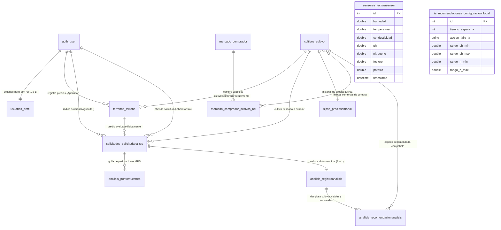

# Documentación Técnica Integral y Arquitectura de Software — TierSystem v1.0

> **Plataforma Integral de Caracterización Edafológica, Inferencia Agronómica Asistida por Inteligencia Artificial y Monitoreo de Mercado para el Departamento del Huila.**
> 
> *Documento de Referencia Técnica y Operativa Exhaustiva — Generado para desarrolladores, agrónomos, administradores y personal técnico.*

---

## Tabla de Contenido

1. [Visión General y Propósito del Sistema](#1-visión-general-y-propósito-del-sistema)
2. [Arquitectura del Software: Patrón MVT de Django y Ecosistema Híbrido](#2-arquitectura-del-software-patrón-mvt-de-django-y-ecosistema-híbrido)
   - 2.1 ¿Qué es el Patrón MVT (Modelo - Vista - Template)?
   - 2.2 Desglose de Capas en TierSystem (Modelo, Vista, Template)
   - 2.3 Arquitectura Híbrida: Web SSR + API REST Móvil + PWA Offline + Hardware IoT
3. [Estructura Detallada del Proyecto y Carpetas](#3-estructura-detallada-del-proyecto-y-carpetas)
4. [Estructura de Base de Datos Exhaustiva (MySQL / MariaDB)](#4-estructura-de-base-de-datos-exhaustiva-mysql--mariadb)
   - 4.1 Entidad Central de Dominio: `Cultivo` (`cultivos_cultivo`)
   - 4.2 Modelo de Usuarios y RBAC: `User` y `Perfil` (`usuarios_perfil`)
   - 4.3 Módulo Espacial y Cartográfico: `Terreno` (`terrenos_terreno`)
   - 4.4 Flujo de Negocio: `SolicitudAnalisis` (`solicitudes_solicitudanalisis`)
   - 4.5 Muestreo Edafológico 3D: `PuntoMuestreo` (`analisis_puntomuestreo`)
   - 4.6 Resultados y Dictamen Agronómico: `RegistroAnalisis` (`analisis_registroanalisis`)
   - 4.7 Recomendaciones Desacopladas: `RecomendacionAnalisis` (`analisis_recomendacionanalisis`)
   - 4.8 Telemetría Temporal IoT: `LecturaSensor` (`sensores_lecturasensor`)
   - 4.9 Gobernanza y Resiliencia de IA: `ConfiguracionGlobal` (`ia_recomendaciones_configuracionglobal`)
   - 4.10 Mercado Agropecuario: `Comprador` y `PrecioSemanal` (`mercado_comprador`, `sipsa_preciosemanal`)
   - 4.11 Diagrama Entidad-Relación Completo (Mermaid)
5. [Justificación de Variables Agronómicas y Técnicas](#5-justificación-de-variables-agronómicas-y-técnicas)
   - 5.1 ¿Por qué se guardan Altitud (msnm), Latitud y Longitud?
   - 5.2 ¿Por qué se evalúan los 7 Parámetros Fisicoquímicos (pH, N, P, K, CE, Humedad, Temp)?
   - 5.3 ¿Por qué se registran Hectáreas y Polígonos GeoJSON?
6. [El Debate Arquitectónico: ¿Cuándo y Por Qué Base de Datos Relacional vs Formatos JSON?](#6-el-debate-arquitectónico-cuándo-y-por-qué-base-de-datos-relacional-vs-formatos-json)
   - 6.1 Principios de la Base de Datos Relacional (Integridad, ACID, Índices, JOINs)
   - 6.2 Casos de Uso Específicos de Formatos JSON en TierSystem
   - 6.3 Matriz de Persistencia: ¿Dónde se almacena cada dato y en qué formato?
7. [Arquitectura y Operación en Modo Offline (En Campo sin Conexión)](#7-arquitectura-y-operación-en-modo-offline-en-campo-sin-conexión)
   - 7.1 El Desafío de la Conectividad Rural en el Huila
   - 7.2 Implementación con IndexedDB y Dexie.js (`db.js`)
   - 7.3 Ciclo en Tres Fases: Precarga -> Captura/Inferencia Local -> Sincronización Masiva
   - 7.4 Algoritmo Heurístico Edafológico Determinista Local
8. [Diccionario y Traducción de Códigos, Expresiones y Sintaxis de Django](#8-diccionario-y-traducción-de-códigos-expresiones-y-sintaxis-de-django)
   - 8.1 Decoradores de Vistas (`@login_required`, `@csrf_exempt`, `@api_view`, `@permission_classes`)
   - 8.2 Consultas Avanzadas del ORM (`select_related`, `prefetch_related`, `bulk_create`, `aggregate`, `update_or_create`)
   - 8.3 Transacciones Atómicas (`transaction.atomic`)
   - 8.4 Ciclo de Vida y Señales (`@receiver(post_save, sender=User)`)
   - 8.5 Desescalado de Señales Industriales Modbus RTU (Factores de Escala)
   - 8.6 Filtrado Estadístico Digital Anti-Ruido (`statistics.mode` y `statistics.median`)
   - 8.7 Sintaxis de Plantillas de Django (``, ``, ``, filtros `|floatformat`)
9. [Flujo de Vida de los Datos: Paso a Paso de Punta a Punta](#9-flujo-de-vida-de-los-datos-paso-a-paso-de-punta-a-punta)
   - 9.1 Flujo del Agricultor (Registro, Lote, Solicitud, Monitoreo)
   - 9.2 Flujo del Laboratorista (Bandeja, Aceptación, Muestreo GPS, Dictamen, Compartición)
   - 9.3 Flujo del Sensor IoT (ESP32, Sonda RS485, Ingesta, Estabilización)
   - 9.4 Flujo de Inteligencia Artificial (Prompting con Gemini, Salvaguarda Anti-Alucinación, Fallback)
   - 9.5 Flujo de Mercado e Inteligencia Comercial (SIPSA/DANE, Regresión Lineal, Compradores)
10. [Catálogo Completo de Rutas URL, Vistas, Modelos y Plantillas](#10-catálogo-completo-de-rutas-url-vistas-modelos-y-plantillas)
11. [Migraciones de Base de Datos y Comandos de Gestión (`management commands`)](#11-migraciones-de-base-de-datos-y-comandos-de-gestión-management-commands)
12. [Guía de Puesta en Marcha y Despliegue](#12-guía-de-puesta-en-marcha-y-despliegue)

---

## 1. Visión General y Propósito del Sistema

**TierSystem** es un ecosistema agrotecnológico de precisión diseñado para transformar la toma de decisiones agronómicas en el departamento del Huila, Colombia. El territorio huilense se caracteriza por su topografía montañosa, su gran diversidad de pisos bioclimáticos (desde el valle cálido del río Magdalena hasta las zonas cafeteras altas de Pitalito, Garzón, La Plata y San Agustín) y la prevalencia de economías campesinas dedicadas a la producción de café especial, cacao fino de aroma, pasifloras (cholupa y maracuyá), frutas de clima frío y cereales.

Históricamente, los análisis físico-químicos de suelos para pequeños productores enfrentan tres graves barreras:
1. **Altos costos y demoras de laboratorio tradicional**: El envío de muestras físicas a centros especializados toma semanas o meses, impidiendo intervenciones nutricionales oportunas en los cultivos.
2. **Brecha de conectividad digital en zonas rurales**: Gran parte de las fincas productoras se encuentran en veredas sin cobertura celular (3G/4G) o con caídas frecuentes del servicio, lo que inhabilita los sistemas basados exclusivamente en la nube.
3. **Desconexión entre el diagnóstico edafológico y la comercialización**: Tras conocer la aptitud de un suelo, el productor no dispone de información actualizada sobre los precios de mercado ni sobre canales comerciales directos para vender su cosecha a precios justos.

### Solución Integral de TierSystem
Para resolver estos problemas, TierSystem articula:
- **Captura IoT en tiempo real**: Mediante una sonda industrial N-P-K 7 en 1 conectada por bus industrial RS485 (protocolo Modbus RTU) a un microcontrolador ESP32 con conectividad WiFi/Bluetooth.
- **Cuadrícula de muestreo georreferenciada en 3D**: Densidad de perforaciones calculada por algoritmo según las hectáreas del lote (de 5 a 20 puntos con latitud, longitud y altitud barométrica/GPS).
- **Inferencia Agronómica Híbrida Resiliente**:
  - **Online**: Motor de Inteligencia Artificial Generativa con Google Gemini Flash, contextualizado con el conocimiento agrícola regional del Huila y protegido por una regla estricta anti-alucinaciones (los porcentajes de afinidad matemática son inyectados desde la base de datos).
  - **Offline**: Motor edafológico heurístico local escrito en Python y JavaScript que evalúa la distancia euclidiana de nutrientes contra los requerimientos óptimos de la especie sin requerir internet.
- **Persistencia Híbrida y Funcionamiento Desconectado**: PWA con almacenamiento local estructurado en IndexedDB (Dexie.js), capaz de ejecutar todo el protocolo de campo sin red y sincronizar en bloque contra MySQL al detectar conectividad.
- **Inteligencia de Mercado Agropecuario**: Integración continua con el Sistema de Información de Precios y Abastecimiento del Sector Agropecuario (SIPSA) del DANE a través de APIs de datos abiertos del gobierno colombiano (datos.gov.co / Socrata), modelos de predicción de tendencias por regresión lineal y directorio de compradores y cooperativas regionales (CADEFIHUILA, Surabastos, etc.).

---

## 2. Arquitectura del Software: Patrón MVT de Django y Ecosistema Híbrido

### 2.1 ¿Qué es el Patrón MVT (Modelo - Vista - Template)?
Django implementa una variante especializada del patrón tradicional MVC (Modelo - Vista - Controlador) denominada **MVT (Model - View - Template)**:

```
    ┌────────────────────────────────────────────────────────┐
    │                      NAVEGADOR / CLIENTE               │
    └───────────┬────────────────────────────────▲───────────┘
     1. Request │ HTTP                           │ 6. Response HTML/JSON
                ▼                                │
    ┌───────────────────────┐                    │
    │      urls.py          │                    │
    │  (Enrutador de URL)   │                    │
    └───────────┬───────────┘                    │
     2. Resuelve│ ruta                           │
                ▼                                │
    ┌─────────────────────────────────────────┐  │
    │               VISTA (View)              │  │
    │            (Lógica de Negocio)          ├──┘
    │  - Valida permisos y roles (RBAC)       │
    │  - Consulta / Escribe en el ORM         │
    │  - Ejecuta algoritmos y servicios       │
    └───────────┬─────────────────────────▲───┘
      3. Query  │ ORM             5. Pasa │ Contexto
                ▼                         │ Data
    ┌───────────────────────┐   ┌─────────┴─────────────┐
    │     MODELO (Model)    │   │    TEMPLATE (Plantilla)│
    │   (Capa de Datos/DB)  │   │  (Presentación UI/UX) │
    │  - Clases Python      │   │  - HTML5 Semántico    │
    │  - Mapeo a MySQL      │   │  - Tags  y {{ }} │
    │  - Reglas de dominio  │   │  - Tailwind CSS       │
    └───────────────────────┘   └───────────────────────┘
```

A diferencia de MVC:
- El framework Django asume automáticamente el rol del **Controlador central**: intercepta la petición HTTP entrante, la analiza mediante el archivo `urls.py`, empaqueta la sesión y las cookies, y la entrega a la función o clase encargada.
- La **Vista (`views.py`)** en Django equivale al **Controlador** en MVC: contiene toda la lógica de control, interactúa con la base de datos a través del ORM, procesa formularios, valida reglas de negocio y decide qué respuesta emitir.
- El **Template (`.html`)** equivale a la **Vista** en MVC: es el componente visual encargado de renderizar la información hacia el usuario final mediante el motor de plantillas de Django (DTL - Django Template Language).

### 2.2 Desglose de Capas en TierSystem

#### 1. Capa de Modelos (`models.py`)
Es la abstracción en código Python de las tablas de la base de datos MySQL. En lugar de escribir sentencias SQL manuales (`CREATE TABLE`, `INSERT`, `SELECT`), cada modelo hereda de `django.db.models.Model`. Cada atributo de la clase representa una columna de la tabla (`CharField`, `DecimalField`, `ForeignKey`, etc.). El ORM (Object-Relational Mapping) de Django traduce automáticamente estas clases en esquemas relacionales fuertemente tipados con claves primarias, foráneas e índices.

#### 2. Capa de Vistas (`views.py`)
En TierSystem, las vistas están diseñadas predominantemente como **Vistas Basadas en Funciones (FBV - Function-Based Views)** y controladores de API con **Django REST Framework (`@api_view`)**. Cada función recibe como primer parámetro un objeto `request` (que contiene las cabeceras HTTP, el usuario autenticado, datos GET/POST y la sesión activa) y está obligada a retornar un objeto `HttpResponse` (renderizado de HTML con plantilla) o un `JsonResponse` / `Response` (serialización de datos JSON para peticiones AJAX o aplicaciones móviles).

#### 3. Capa de Templates (`templates/`)
Archivos HTML5 enriquecidos con la sintaxis propia de Django:
- ``: Sentencias lógicas de control de flujo (bucles `for`, condicionales `if`, bloques de herencia `block content`, protección CSRF ``).
- `{{ variable }}`: Interpolación de valores de variables enviadas desde el diccionario de contexto de la vista (ej. `{{ cultivo.nombre }}`, `{{ solicitud.id }}`).
- `{{ variable|filtro }}`: Modificadores de presentación visual (ej. `{{ punto.ph|floatformat:1 }}`, `{{ precio|intcomma }}`).

### 2.3 Arquitectura Híbrida: Web SSR + API REST Móvil + PWA Offline + Hardware IoT

TierSystem no es una aplicación web monolítica aislada; opera mediante una arquitectura multicapa altamente coordinada:

```
 ┌──────────────────────────────────────────────────────────────────────────────────┐
 │                           CAPA DE CLIENTES Y USUARIOS                            │
 ├─────────────────────────┬──────────────────────────┬─────────────────────────────┤
 │   Navegador Web Desktop │     PWA Móvil en Campo   │    App Móvil Nativa         │
 │   (Administrador / Lab) │   (Laboratorista Offline)│   (Flutter / Agricultor)    │
 └────────────┬────────────┴─────────────┬────────────┴──────────────┬──────────────┘
              │ HTML / Cookies           │ IndexedDB + Fetch JSON    │ JWT Bearer / JSON
              ▼                          ▼                           ▼
 ┌──────────────────────────────────────────────────────────────────────────────────┐
 │                        SERVIDOR DE APLICACIONES (DJANGO)                         │
 │                                                                                  │
 │  ┌───────────────────────┐  ┌─────────────────────────┐  ┌────────────────────┐  │
 │  │   Rutas Web Clásicas  │  │   API REST v1 (DRF)     │  │  Endpoints IoT     │  │
 │  │   - Sesiones por cookie│  │   - JWT Auth (SimpleJWT)│  │  - Header X-API-Key│  │
 │  │   - Plantillas DTL    │  │   - Swagger OpenAPI 3.0 │  │  - Parser Modbus   │  │
 │  └───────────┬───────────┘  └────────────┬────────────┘  └──────────┬─────────┘  │
 │              │                           │                          │            │
 │              └───────────────────────────┼──────────────────────────┘            │
 │                                          ▼                                       │
 │                      CAPA DE SERVICIOS Y LÓGICA DE NEGOCIO                       │
 │  ┌───────────────────────┐  ┌─────────────────────────┐  ┌────────────────────┐  │
 │  │ Motor IA Google Gemini│  │ Motor Heurístico Local  │  │ Ingesta SIPSA/DANE │  │
 │  │ (Inferencia Online)   │  │ (Algoritmo Determinista)│  │ (API Socrata DANE) │  │
 │  └───────────────────────┘  └─────────────────────────┘  └────────────────────┘  │
 └──────────────────────────────────────────┬───────────────────────────────────────┘
                                            ▼
 ┌──────────────────────────────────────────────────────────────────────────────────┐
 │                     CAPA DE PERSISTENCIA (MYSQL RELACIONAL)                      │
 │  - Catálogo Maestro Cultivos (`cultivos_cultivo`)                                │
 │  - Usuarios y Perfiles (`auth_user`, `usuarios_perfil`)                          │
 │  - Fincas y Parcelas (`terrenos_terreno`)                                        │
 │  - Solicitudes de Servicio (`solicitudes_solicitudanalisis`)                     │
 │  - Grilla de Muestreo 3D (`analisis_puntomuestreo`)                              │
 │  - Consolidado Edafológico (`analisis_registroanalisis`)                         │
 │  - Recomendaciones Específicas (`analisis_recomendacionanalisis`)                │
 │  - Buffer de Telemetría IoT (`sensores_lecturasensor`)                           │
 │  - Series de Precios Agropecuarios (`sipsa_preciosemanal`)                       │
 └──────────────────────────────────────────────────────────────────────────────────┘
                                            ▲
                                            │ Tramas Modbus RTU / WiFi
 ┌──────────────────────────────────────────┴───────────────────────────────────────┐
 │                       CAPA DE DISPOSITIVOS DE CAMPO (IoT)                        │
 │  - Microcontrolador ESP32 (Firmware C++ FreeRTOS)                                │
 │  - Transceptor RS485 (Half-Duplex MAX485)                                        │
 │  - Sonda Industrial de Suelo NPK 7 en 1 (Acero Inoxidable 316)                  │
 └──────────────────────────────────────────────────────────────────────────────────┘
```

---

## 3. Estructura Detallada del Proyecto y Carpetas

El repositorio está organizado siguiendo el estándar modular de proyectos empresariales en Django, separando responsabilidades por dominios de negocio claramente delimitados:

```
TierSystem-Django/
├── manage.py                          # Script de consola central de Django (comandos, servidor, migraciones)
├── requirements.txt                   # Manifiesto de dependencias de Python (Django, DRF, ReportLab, etc.)
├── seed_cultivos.py                   # Script de poblamiento inicial de los cultivos comerciales del Huila
├── tiersystem_db.sql                  # Respaldo estructural y datos maestros en SQL puro para MySQL
├── .env / .env.example                # Variables de entorno secretas (DB credenciales, GEMINI_API_KEY, SECRET_KEY)
│
├── tiersystem/                        # NÚCLEO DE CONFIGURACIÓN DEL PROYECTO DJANGO
│   ├── __init__.py                    # Inicializador de paquete Python
│   ├── settings.py                    # Configuración global (INSTALLED_APPS, DATABASES, AUTH, MIDDLEWARE)
│   ├── urls.py                        # Enrutador principal de URLs raíz que delega a cada app
│   ├── asgi.py                        # Punto de entrada para servidores asíncronos ASGI
│   └── wsgi.py                        # Punto de entrada para servidores web tradicionales WSGI (Apache/Nginx/Gunicorn)
│
├── core/                              # CONTROLADOR TRANSVERSAL Y VISTAS DE ADMINISTRACIÓN
│   ├── views.py                       # Vistas del dashboard de admin, supervisión, gestión de hardware y usuarios
│   ├── urls.py                        # Rutas base del home y paneles administrativos
│   ├── context_processors.py          # Variables globales inyectadas en todas las plantillas (año, versión)
│   └── mixins.py / permissions.py     # Decoradores y validadores de acceso por rol
│
├── apps/                              # DOMINIOS DE NEGOCIO (APLICACIONES DJANGO DESACOPLADAS)
│   │
│   ├── usuarios/                      # GOBERNANZA DE IDENTIDAD Y ACCESO (RBAC)
│   │   ├── models.py                  # Perfil (OneToOne con User, rol: AGRICULTOR, LABORATORISTA, ADMIN)
│   │   ├── views.py                   # Login multirrol, registro de agricultor, perfil y cambio de clave
│   │   ├── forms.py                   # Formularios validados de registro y autenticación
│   │   └── urls.py                    # Rutas de autenticación (/login, /register, /perfil, /logout)
│   │
│   ├── terrenos/                      # CARTOGRAFÍA Y GESTIÓN DE PREDIOS AGRÍCOLAS
│   │   ├── models.py                  # Terreno (lotes, hectáreas, altitud msnm, GeoJSON del polígono)
│   │   ├── views.py                   # CRUD AJAX de fincas y vinculación al cultivo establecido
│   │   └── urls.py                    # Rutas (/mis-terrenos, /crear, /editar, /eliminar)
│   │
│   ├── cultivos/                      # CATÁLOGO MAESTRO UNIVERSAL DE ESPECIES DEL HUILA
│   │   ├── models.py                  # Cultivo (taxonomía, rangos óptimos de pH, N-P-K, humedad, temp, CE, msnm)
│   │   ├── views.py                   # Visualización pública y de consulta del catálogo
│   │   └── urls.py                    # Rutas de consulta de especies y variedades
│   │
│   ├── solicitudes/                   # CICLO DE VIDA DE ÓRDENES DE SERVICIO
│   │   ├── models.py                  # SolicitudAnalisis (máquina de estados, modalidad visita/laboratorio)
│   │   ├── views.py                   # Bandeja de entrada laboratorista, aceptación, rechazo y reportes
│   │   ├── urls.py                    # Rutas del laboratorista (/pendientes, /asignadas, /aceptar, /rechazar)
│   │   └── urls_agricultor.py         # Rutas del agricultor (/mis-solicitudes, /historial, /comparar, /exportar)
│   │
│   ├── analisis/                      # PROCESAMIENTO EDAFOLÓGICO Y MUESTREO 3D
│   │   ├── models.py                  # RegistroAnalisis, PuntoMuestreo (grilla 3D) y RecomendacionAnalisis
│   │   ├── views.py                   # Histórico de análisis técnicos completados
│   │   └── urls.py                    # Rutas de consulta técnica
│   │
│   ├── sensores/                      # TELEMETRÍA IoT Y HARDWARE DE CAMPO
│   │   ├── models.py                  # LecturaSensor (buffer temporal de telemetría sin procesar)
│   │   ├── views.py                   # Ingesta POST con X-API-Key y filtro anti-ruido captura_estable (moda/mediana)
│   │   └── urls.py                    # Endpoints (/lecturas/, /captura-estable/, /punto/<id>/guardar/)
│   │
│   ├── ia_recomendaciones/            # MOTOR DE INFERENCIA AGRONÓMICA (ONLINE / OFFLINE)
│   │   ├── models.py                  # ConfiguracionGlobal (Singleton: timeout de IA, fallback a BD local)
│   │   ├── views.py                   # Inferencia con Google Gemini, cálculo heurístico, sincronización offline
│   │   └── urls.py                    # Rutas (/diagnosticar/, /sincronizar-offline/, /promedio-puntos/)
│   │
│   ├── mercado/                       # CANALES COMERCIALES Y DIRECTORIO REGIONAL
│   │   ├── models.py                  # Comprador (cooperativas, plazas mayoristas, intermediarios del Huila)
│   │   ├── views.py                   # Tablero de mercado regional, cotizaciones y directorio comercial
│   │   ├── urls.py                    # Rutas (/mercado/, /compradores/)
│   │   └── management/commands/       # Comando actualizar_precios (proxy a actualizar_sipsa)
│   │
│   └── sipsa/                         # MONITOREO ESTADÍSTICO DE PRECIOS SIPSA / DANE
│       ├── models.py                  # PrecioSemanal (cotización nacional y cálculo del mercado regional Huila ~97%)
│       ├── prediccion.py              # Algoritmo de regresión lineal para proyección de precios a 4 semanas
│       ├── views.py                   # Tablero comparativo histórico y gráficas temporales
│       ├── urls.py                    # Rutas (/dashboard/, /detalle/<id>/, /api/precios/)
│       └── management/commands/       # Comando canónico actualizar_sipsa (consume APIs de datos.gov.co)
│
├── api/                               # SERVICIOS REST MÓVILES (DJANGO REST FRAMEWORK + JWT)
│   ├── urls.py                        # Enrutador /api/v1/ (Swagger /docs/, esquema /schema/)
│   ├── permissions.py                 # Clases de autorización personalizadas (IsAgricultor, IsLaboratorista)
│   ├── auth/                          # Autenticación JWT (login, refresh, registro móvil)
│   ├── agricultor/                    # Endpoints móviles del agricultor (fincas, solicitudes, historial)
│   └── laboratorista/                 # Endpoints móviles de campo (muestreo en cuadrícula, lecturas IoT, consolidación)
│
├── templates/                         # CAPA DE PRESENTACIÓN VISUAL (DJANGO TEMPLATE LANGUAGE)
│   ├── base.html                      # Layout maestro global (meta tags, estilos locales, scripts base)
│   ├── home.html                      # Landing page pública institucional
│   ├── admin/                         # Plantillas exclusivas del administrador (dashboard, supervision, hardware, usuarios)
│   ├── laboratorista/                 # Plantillas de campo (toma_muestras.html con Leaflet 3D, solicitudes_pendientes)
│   ├── agricultor/                    # Plantillas del campesino (dashboard, terrenos, solicitudes, historial, comparar)
│   ├── sipsa/                         # Tableros de series temporales de precios
│   └── emails/                        # Plantillas HTML para despachos automáticos SMTP
│
├── static/                            # ASSETS ESTÁTICOS COMPILADOS LOCALMENTE (AUTÓNOMOS SIN CDN)
│   ├── css/                           # Estilos CSS
│   ├── js/                            # Lógica JavaScript
│   │   ├── db.js                      # Base de datos cliente IndexedDB / Dexie.js para soporte 100% offline
│   │   ├── service-worker.js          # Cacheo de vistas y activos estáticos para PWA
│   │   └── tailwindcss.js             # Motor Tailwind CSS servido localmente
│   └── webfonts/                      # Tipografías e iconos vectoriales FontAwesome locales
│
├── media/                             # ARCHIVOS SUBIDOS DINÁMICAMENTE POR USUARIOS
└── documentacion/                     # ESPECIFICACIONES TÉCNICAS, INFORMES Y MANUALES
```

---

## 4. Estructura de Base de Datos Exhaustiva (MySQL / MariaDB)

La arquitectura de datos de TierSystem sigue un diseño **relacional en Tercera Forma Normal (3NF)** alojado en MySQL. La base de datos garantiza consistencia transaccional (ACID), integridad referencial estricta mediante claves foráneas y un desacoplamiento limpio entre entidades.

A continuación se detalla cada tabla física, sus columnas, tipos de datos, restricciones e importancia técnica y agronómica:

---

### 4.1 Entidad Central de Dominio: `Cultivo` (Tabla: `cultivos_cultivo`)

Es el corazón del conocimiento agronómico del sistema. Ninguna solicitud, recomendación ni análisis puede existir sin contrastarse contra esta tabla maestra. Representa la ficha agroecológica de cada especie productiva del Huila.

| Campo | Tipo SQL | Null / Default | Propósito Agronómico y Técnico |
| :--- | :--- | :---: | :--- |
| `id` | `INT AUTO_INCREMENT` | PK | Identificador único numérico del cultivo. |
| `nombre` | `VARCHAR(120)` | UNIQUE | Nombre comercial o común (ej. "Café Castillo", "Cacao CCN-51", "Cholupa del Huila"). |
| `nombre_cientifico`| `VARCHAR(150)` | Default: `''` | Denominación botánica formal (ej. *Coffea arabica*, *Theobroma cacao*). |
| `categoria` | `VARCHAR(80)` | Default: `'Frutal'`| Categoría productiva: Frutal, Cereal, Tubérculo, Leguminosa, Hortaliza, Industrial. |
| `clima` | `VARCHAR(80)` | Default: `'Templado'`| Piso bioclimático predominante: Cálido, Templado, Frío. |
| `icono` | `VARCHAR(60)` | Default: `'fa-seedling'`| Clase CSS de FontAwesome para renderizado en tarjetas visuales de la UI. |
| `descripcion` | `LONGTEXT` | Blank | Resumen fisiológico, requerimientos de luminosidad y comportamiento agronómico regional. |
| `altitud_min` | `DECIMAL(7,2)` | Default: `0.00` | Cota altitudinal mínima recomendada en metros sobre el nivel del mar (msnm). |
| `altitud_max` | `DECIMAL(7,2)` | Default: `3000.00`| Cota altitudinal máxima recomendada en msnm. Evita recomendar especies en pisos incompatibles. |
| `ph_min` | `DECIMAL(4,2)` | Default: `5.50` | Límite inferior de pH de suelo tolerado sin presentar fitotoxicidad o deficiencias de absorción. |
| `ph_max` | `DECIMAL(4,2)` | Default: `6.80` | Límite superior de pH admisible. |
| `humedad_min` | `DECIMAL(5,2)` | Default: `60.00`| Porcentaje mínimo de humedad volumétrica del suelo para evitar punto de marchitez permanente. |
| `humedad_max` | `DECIMAL(5,2)` | Default: `80.00`| Porcentaje máximo antes de provocar anoxia radicular y pudriciones fúngicas. |
| `temperatura_min`| `DECIMAL(5,2)` | Default: `18.00`| Temperatura edáfica mínima (°C) para desarrollo de actividad microbiana y radicular. |
| `temperatura_max`| `DECIMAL(5,2)` | Default: `26.00`| Temperatura edáfica máxima (°C) antes de estrés térmico celular. |
| `conductividad_min`| `DECIMAL(8,2)` | Default: `0.80` | Salinidad mínima (dS/m o mS/cm). Concentración iónica necesaria en la solución del suelo. |
| `conductividad_max`| `DECIMAL(8,2)` | Default: `2.20` | Salinidad máxima tolerable antes de inducir estrés osmótico inverso en las raíces. |
| `nitrogeno_min` | `DECIMAL(6,2)` | Default: `120.00`| Demanda crítica mínima de Nitrógeno asimilable disponible (mg/kg o ppm). |
| `nitrogeno_max` | `DECIMAL(6,2)` | Default: `250.00`| Límite superior óptimo de Nitrógeno antes de provocar desarrollo vegetativo excesivo y susceptibilidad a plagas. |
| `fosforo_min` | `DECIMAL(6,2)` | Default: `25.00` | Fósforo disponible mínimo (mg/kg) para elongación radicular y fijación energética (ATP). |
| `fosforo_max` | `DECIMAL(6,2)` | Default: `65.00` | Límite superior óptimo de Fósforo. |
| `potasio_min` | `DECIMAL(6,2)` | Default: `140.00`| Potasio intercambiable mínimo (mg/kg) para regulación estomática y turgencia celular. |
| `potasio_max` | `DECIMAL(6,2)` | Default: `280.00`| Límite superior de Potasio antes de inducir antagonismos con Calcio y Magnesio. |
| `nombre_dane` | `VARCHAR(120)` | Default: `''` | Nombre exacto con el que figura la especie en el catálogo SIPSA/DANE para homologación de precios. |
| `activo` | `TINYINT(1)` | Default: `1` | Bandera booleana para habilitar o inhabilitar el cultivo sin eliminar su historial. |
| `fecha_creacion`| `DATETIME` | Auto | Marca temporal de auditoría de creación. |
| `fecha_actualizacion`| `DATETIME` | Auto | Marca temporal de última modificación en los rangos. |

---

### 4.2 Modelo de Usuarios y RBAC: `User` y `Perfil` (Tabla: `usuarios_perfil`)

Extiende el modelo de autenticación estándar de Django (`auth_user`) mediante una relación uno a uno (`OneToOneField`), implementando el Control de Acceso Basado en Roles (RBAC - Role-Based Access Control).

| Campo | Tipo SQL | Null / Default | Propósito Técnico |
| :--- | :--- | :---: | :--- |
| `id` | `INT AUTO_INCREMENT` | PK | Identificador del perfil. |
| `user_id` | `INT` | UNIQUE / FK | Clave foránea en cascada (`ON DELETE CASCADE`) que vincula exactamente un registro de `auth_user`. |
| `rol` | `VARCHAR(20)` | Default: `'AGRICULTOR'` | Rol operativo en el sistema: `'AGRICULTOR'`, `'LABORATORISTA'`, `'ADMIN'`. Gobierna las rutas accesibles. |
| `telefono` | `VARCHAR(20)` | NULL | Línea telefónica o móvil del productor o técnico para coordinación logística de visitas. |

---

### 4.3 Módulo Espacial y Cartográfico: `Terreno` (Tabla: `terrenos_terreno`)

Representa la parcela o lote productivo del agricultor donde se programa la caracterización de suelo.

| Campo | Tipo SQL | Null / Default | Propósito Agronómico y Técnico |
| :--- | :--- | :---: | :--- |
| `id` | `INT AUTO_INCREMENT` | PK | Identificador del terreno. |
| `agricultor_id` | `INT` | FK (`auth_user`) | Dueño del predio. Permite el aislamiento multi-inquilino (un agricultor no ve fincas de otros). |
| `nombre` | `VARCHAR(100)` | No Null | Nombre identificador del predio (ej. "Finca El Paraíso", "Lote Los Guaduales"). |
| `ubicacion` | `VARCHAR(255)` | No Null | Vereda, corregimiento o municipio (ej. "Vereda Bajo San Francisco, Pitalito"). |
| `hectareas` | `DECIMAL(8,2)` | No Null | Superficie en hectáreas. Determina el número de puntos de muestreo en campo (5 a 20). |
| `cultivo_ref_id`| `INT` | FK (`cultivos_cultivo`)| Clave foránea al cultivo establecido actualmente en el lote (o `NULL` si el lote está virgen/descanso). |
| `altitud_promedio`| `DECIMAL(7,2)` | NULL | Altitud sobre el nivel del mar (msnm) calculada por altimetría GPS o modelo digital de elevación. |
| `coordenadas_poligono`| `LONGTEXT` | NULL | Cadena serializada en formato GeoJSON que contiene los vértices del polígono dibujado en Leaflet. |
| `fecha_registro`| `DATETIME` | Auto | Marca temporal de alta del predio en la plataforma. |

---

### 4.4 Flujo de Negocio: `SolicitudAnalisis` (Tabla: `solicitudes_solicitudanalisis`)

Articula el acuerdo de servicio y la máquina de estados entre el agricultor y el laboratorio de suelos.

| Campo | Tipo SQL | Null / Default | Propósito Operativo |
| :--- | :--- | :---: | :--- |
| `id` | `INT AUTO_INCREMENT` | PK | Número formal de radicado de la orden de análisis (ej. Solicitud #104). |
| `agricultor_id` | `INT` | FK (`auth_user`) | Usuario que radica el requerimiento. |
| `terreno_id` | `INT` | FK (`terrenos_terreno`) | Predio físico donde se tomarán las muestras. |
| `laboratorista_asignado_id`| `INT` | NULL / FK (`auth_user`)| Técnico que aceptó atender la solicitud. Si el laboratorista se retira, queda en `NULL` (`SET_NULL`). |
| `estado` | `VARCHAR(20)` | Default: `'PENDIENTE'`| Estado en la máquina de estados: `PENDIENTE`, `ASIGNADA`, `EN_PROCESO`, `COMPLETADA`, `RECHAZADA`, `CANCELADA`. |
| `cultivo_deseado_ref_id` | `INT` | NULL / FK (`cultivos_cultivo`)| Cultivo que el agricultor sueña o proyecta sembrar en ese terreno. Calibra el análisis comparativo. |
| `modalidad` | `VARCHAR(20)` | Default: `'VISITA'`| Modalidad de atención: `VISITA` (toma de muestras en finca) o `LLEVAR_MUESTRA` (recepción en sede técnica). |
| `fecha_solicitud` | `DATETIME` | Auto | Instante exacto de radicación en el sistema. |
| `fecha_visita` | `DATE` | NULL | Fecha programada por el laboratorista para presentarse en la finca del productor. |
| `notas_agricultor` | `LONGTEXT` | NULL | Observaciones históricas: antecedentes de fertilización química, síntomas visibles, historial de plagas. |

---

### 4.5 Muestreo Edafológico 3D: `PuntoMuestreo` (Tabla: `analisis_puntomuestreo`)

Representa cada perforación individual de barreno o inserción de la sonda sensorizada en el terreno dentro de la ruta de muestreo en zig-zag.

| Campo | Tipo SQL | Null / Default | Propósito Físico y Técnico |
| :--- | :--- | :---: | :--- |
| `id` | `INT AUTO_INCREMENT` | PK | Identificador del punto. |
| `solicitud_id` | `INT` | FK (`solicitudes_solicitudanalisis`)| Orden a la cual pertenece la estación de muestreo. |
| `numero` | `INT` | No Null | Número ordinal del punto en la ruta (Punto 1, 2, ... N). |
| `estado` | `VARCHAR(20)` | Default: `'PENDIENTE'`| Estado de recolección en campo: `PENDIENTE` (esperando sensor) o `TOMADO` (medición consolidada). |
| `latitud` | `DECIMAL(10,7)`| NULL | Coordenada GPS latitud en formato decimal WGS84 (precisión milimétrica). |
| `longitud` | `DECIMAL(10,7)`| NULL | Coordenada GPS longitud en formato decimal WGS84. |
| `altitud` | `DECIMAL(7,2)` | NULL | Altitud física real sobre el nivel del mar (msnm) medida en esa perforación específica. |
| `fecha_toma` | `DATETIME` | NULL | Marca temporal exacta de fijación de la lectura en campo. |
| `humedad` | `DECIMAL(5,2)` | NULL | Lectura puntual estabilizada de humedad volumétrica (%). |
| `temperatura` | `DECIMAL(5,2)` | NULL | Lectura puntual estabilizada de temperatura edáfica (°C). |
| `conductividad`| `DECIMAL(8,2)` | NULL | Lectura puntual estabilizada de conductividad eléctrica (µS/cm o dS/m). |
| `ph` | `DECIMAL(4,2)` | NULL | Lectura puntual estabilizada de pH de suelo (0.00 a 14.00). |
| `nitrogeno` | `DECIMAL(6,2)` | NULL | Lectura puntual estabilizada de Nitrógeno asimilable (mg/kg). |
| `fosforo` | `DECIMAL(6,2)` | NULL | Lectura puntual estabilizada de Fósforo disponible (mg/kg). |
| `potasio` | `DECIMAL(6,2)` | NULL | Lectura puntual estabilizada de Potasio asimilable (mg/kg). |

---

### 4.6 Resultados y Dictamen Agronómico: `RegistroAnalisis` (Tabla: `analisis_registroanalisis`)

Es el informe consolidado final emitido para una solicitud. Guarda la media aritmética de todos los puntos de la cuadrícula física y el dictamen global.

| Campo | Tipo SQL | Null / Default | Propósito Analítico |
| :--- | :--- | :---: | :--- |
| `id` | `INT AUTO_INCREMENT` | PK | Identificador oficial del informe de laboratorio. |
| `solicitud_id` | `INT` | UNIQUE / FK | Relación uno a uno estricta (`OneToOneField`) con `SolicitudAnalisis`. Una solicitud solo produce un dictamen final. |
| `humedad` | `DECIMAL(5,2)` | Default: `0.00` | Promedio aritmético consolidado de humedad de la finca (%). |
| `temperatura` | `DECIMAL(5,2)` | Default: `0.00` | Promedio aritmético consolidado de temperatura edáfica (°C). |
| `conductividad`| `DECIMAL(8,2)` | Default: `0.00` | Promedio aritmético consolidado de conductividad eléctrica. |
| `ph` | `DECIMAL(4,2)` | Default: `0.00` | Promedio aritmético consolidado de pH. |
| `nitrogeno` | `DECIMAL(6,2)` | Default: `0.00` | Promedio aritmético consolidado de Nitrógeno (mg/kg). |
| `fosforo` | `DECIMAL(6,2)` | Default: `0.00` | Promedio aritmético consolidado de Fósforo (mg/kg). |
| `potasio` | `DECIMAL(6,2)` | Default: `0.00` | Promedio aritmético consolidado de Potasio (mg/kg). |
| `diagnostico_ia`| `LONGTEXT` | NULL | Cadena serializada JSON con el dictamen narrativo emitido por Gemini o el motor offline para auditoría forense. |
| `fecha_analisis`| `DATETIME` | Auto | Marca temporal formal de cierre del estudio agronómico. |

---

### 4.7 Recomendaciones Desacopladas: `RecomendacionAnalisis` (Tabla: `analisis_recomendacionanalisis`)

Almacena cada especie vegetal evaluada como viable para el lote tras el análisis edafológico. Permite consultar recomendaciones mediante queries SQL directas sin tener que parsear bloques JSON en memoria.

| Campo | Tipo SQL | Null / Default | Propósito Agronómico |
| :--- | :--- | :---: | :--- |
| `id` | `INT AUTO_INCREMENT` | PK | Identificador de la recomendación. |
| `analisis_id` | `INT` | FK (`analisis_registroanalisis`)| Informe de laboratorio del cual se desprende la sugerencia. |
| `cultivo_id` | `INT` | NULL / FK (`cultivos_cultivo`)| Vínculo relacional directo al cultivo sugerido en el catálogo maestro. |
| `nombre_cultivo`| `VARCHAR(120)` | No Null | Nombre textual de la especie (ej. "Café Castillo", "Cacao CCN-51"). |
| `porcentaje_compatibilidad`| `DOUBLE` | Default: `0.0` | Grado de afinidad cuantitativa matemática entre el suelo y la planta (0.0% a 100.0%). |
| `viabilidad` | `VARCHAR(50)` | Default: `'Alta'`| Clasificación cualitativa estandarizada: `'Alta'` (>=80%), `'Media'` (60-79%), `'Baja'` (<60%). |
| `descripcion` | `LONGTEXT` | Blank | Justificación agronómica detallada sobre por qué el cultivo se adapta al suelo actual del lote. |
| `plan_fertilizacion`| `LONGTEXT` | Blank | Plan técnico de enmiendas: aplicaciones de cal dolomita para corregir acidez, dosis NPK y materia orgánica. |

---

### 4.8 Telemetría Temporal IoT: `LecturaSensor` (Tabla: `sensores_lecturasensor`)

Buffer o cola temporal de ingesta de señales brutas en tiempo real transmitidas por la sonda de campo a través del microcontrolador ESP32.

| Campo | Tipo SQL | Null / Default | Propósito Físico y Electrónico |
| :--- | :--- | :---: | :--- |
| `id` | `INT AUTO_INCREMENT` | PK | Identificador secuencial de la trama de telemetría. |
| `humedad` | `DOUBLE` | No Null | Humedad volumétrica bruta desescalada recibida del sensor (%). |
| `temperatura` | `DOUBLE` | No Null | Temperatura edáfica bruta (°C). |
| `conductividad`| `DOUBLE` | No Null | Salinidad bruta en µS/cm o dS/m. |
| `ph` | `DOUBLE` | No Null | pH bruto desescalado (0.0 a 14.0). |
| `nitrogeno` | `DOUBLE` | No Null | Nitrógeno elemental bruto (mg/kg). |
| `fosforo` | `DOUBLE` | No Null | Fósforo elemental bruto (mg/kg). |
| `potasio` | `DOUBLE` | No Null | Potasio elemental bruto (mg/kg). |
| `timestamp` | `DATETIME` | Auto | Marca temporal precisa con microsegundos. Crucial para la ventana móvil de estabilización de 15 segundos. |

---

### 4.9 Gobernanza y Resiliencia de IA: `ConfiguracionGlobal` (Tabla: `ia_recomendaciones_configuracionglobal`)

Modelo estructurado bajo el **Patrón Singleton** (solo existe una única fila con `pk=1`). Centraliza las políticas de tolerancia a fallos del motor de inteligencia artificial y los umbrales de validez física para los sensores.

| Campo | Tipo SQL | Null / Default | Propósito Operativo |
| :--- | :--- | :---: | :--- |
| `id` | `INT` | PK (Forzado: `1`) | Clave primaria fija en 1. Impide registros duplicados de configuración. |
| `tiempo_espera_ia`| `INT` | Default: `30` | Timeout máximo en segundos antes de abortar la petición HTTP a la API de Google Gemini. |
| `accion_fallo_ia` | `VARCHAR(50)` | Default: `'DB_LOCAL'`| Política de contingencia ante caída de Gemini: `'DB_LOCAL'` (conmuta al motor heurístico) o `'CANCELAR'`. |
| `rango_ph_min` / `max` | `DOUBLE` | `0.0` / `14.0` | Umbrales de plausibilidad física para rechazar lecturas corruptas de pH. |
| `rango_n_min` / `max` | `DOUBLE` | `0.0` / `1000.0` | Umbrales de plausibilidad física para Nitrógeno (mg/kg). |
| `rango_p_min` / `max` | `DOUBLE` | `0.0` / `1000.0` | Umbrales de plausibilidad física para Fósforo (mg/kg). |
| `rango_k_min` / `max` | `DOUBLE` | `0.0` / `1000.0` | Umbrales de plausibilidad física para Potasio (mg/kg). |
| `rango_humedad_min`/`max`| `DOUBLE` | `0.0` / `100.0` | Umbrales físicos de humedad (%). |
| `rango_ce_min` / `max` | `DOUBLE` | `0.0` / `20.0` | Umbrales físicos de conductividad eléctrica (dS/m). |
| `rango_temp_min` / `max` | `DOUBLE` | `-10.0` / `60.0` | Umbrales térmicos para descartar averías de termistor (°C). |

---

### 4.10 Mercado Agropecuario: `Comprador` y `PrecioSemanal` (Tablas: `mercado_comprador`, `sipsa_preciosemanal`)

#### Tabla `mercado_comprador`
Almacena el directorio regional de aliados comerciales y centros de acopio en el departamento del Huila.

| Campo | Tipo SQL | Null / Default | Propósito Comercial |
| :--- | :--- | :---: | :--- |
| `id` | `INT AUTO_INCREMENT` | PK | Identificador comercial. |
| `nombre` | `VARCHAR(150)` | No Null | Denominación o razón social (ej. "CADEFIHUILA", "Surabastos", "ASOPEP"). |
| `tipo` | `VARCHAR(50)` | No Null | Clasificación: Cooperativa, Plaza de Mercado, Intermediario, Exportador, Transformador. |
| `municipio` | `VARCHAR(100)` | Default: `'Neiva, Huila'`| Centro logístico o sede de acopio en el Huila. |
| `contacto` | `VARCHAR(100)` | Blank | Teléfono de atención al productor. |
| `precio_referencia`| `VARCHAR(100)` | NULL | Frase o precio indicativo de compra (ej. "$18.600 / kg pergamino"). |
| `activo` | `TINYINT(1)` | Default: `1` | Visibilidad en el directorio de la aplicación. |
| `email` | `VARCHAR(254)` | Blank | Correo para remisión de cotizaciones. |
| `whatsapp` | `VARCHAR(20)` | Blank | Número directo para apertura de chat de mensajería instantánea. |
| `sitio_web` | `VARCHAR(200)` | Blank | Portal web corporativo. |

*Nota sobre relación Muchos a Muchos*: La relación entre `Comprador` y los cultivos de su interés se materializa mediante la tabla intermedia automática de Django `mercado_comprador_cultivos_rel` (`comprador_id`, `cultivo_id`).

#### Tabla `sipsa_preciosemanal`
Series de tiempo oficiales de cotizaciones de alimentos en centrales mayoristas (SIPSA / DANE).

| Campo | Tipo SQL | Null / Default | Propósito Estadístico y Económico |
| :--- | :--- | :---: | :--- |
| `id` | `INT AUTO_INCREMENT` | PK | Identificador de la cotización semanal. |
| `cultivo_id` | `INT` | FK (`cultivos_cultivo`)| Cultivo oficial al que corresponde la cotización. |
| `fecha_semana` | `DATE` | No Null | Fecha canónica del lunes de la semana evaluada. |
| `semana_label` | `VARCHAR(30)` | No Null | Etiqueta estándar ISO 8601 (ej. "Sem 42-2026"). |
| `precio_kg` | `DECIMAL(12,2)`| No Null | Precio mayorista promedio nacional en COP por kilogramo. |
| `precio_local` | `DECIMAL(12,2)`| NULL | Precio regional estimado en el Huila (~97% del promedio nacional en Surabastos). |
| `mercado_referencia`| `VARCHAR(200)`| Default: `'SIPSA Mayoristas'`| Plaza de origen de la muestra estadística. |
| `fuente` | `VARCHAR(300)` | Default: `'SIPSA / DANE'`| Entidad emisora de la estadística oficial. |
| `fuente_url` | `VARCHAR(500)` | Blank | Enlace a la API pública Socrata en datos.gov.co. |
| `fecha_registro` | `DATETIME` | Auto | Marca temporal de sincronización en el sistema. |

*Restricción de unicidad estricta*: `UNIQUE KEY ('cultivo_id', 'fecha_semana')`. Impide duplicar cotizaciones de la misma semana para un cultivo.

---

### 4.11 Diagrama Entidad-Relación Completo (Mermaid)



---

## 5. Justificación de Variables Agronómicas y Técnicas

En TierSystem, ninguna variable se almacena al azar; cada parámetro físico, químico y geográfico responde a leyes científicas de la agronomía y a las realidades agroecológicas del Huila.

### 5.1 ¿Por qué se guardan Altitud (msnm), Latitud y Longitud?

#### Altitud sobre el nivel del mar (msnm)
En la geografía colombiana, la altitud es el regulador primordial de la **temperatura atmosférica** y de los **pisos térmicos** (regla aproximada: la temperatura desciende aproximadamente $0.6^\circ\text{C}$ por cada 100 metros de elevación).
- **Ejemplo en el Café (*Coffea arabica*)**: El café tecnificado en el Huila requiere pisos altitudinales estrictamente comprendidos entre **$1.200\text{ msnm}$ y $1.850\text{ msnm}$**.
  - Si un agricultor solicita evaluar su suelo para Café en una finca ubicada a **$650\text{ msnm}$** (valle del río Magdalena, ej. Villavieja o Palermo bajo), aunque el suelo tenga un pH y NPK perfectos, la alta temperatura ambiental y la baja altitud causarán aborto floral, quemazón de brotes y proliferación descontrolada de la broca (*Hypothenemus hampei*).
  - Si la finca se sitúa a **$2.400\text{ msnm}$**, el frío extremo y el riesgo de heladas impedirán la maduración del grano.
- Por ello, el algoritmo de idoneidad penaliza severamente a los cultivos si la altitud media del terreno cae fuera de su intervalo $[\text{altitud\_min}, \text{altitud\_max}]$.

#### Latitud y Longitud (Georreferenciación 3D WGS84)
- **Trazabilidad y Auditoría en Campo**: Garantiza que el laboratorista efectivamente caminó el terreno y perforó la tierra en las coordenadas geográficas de la finca, evitando fraudes o tomas de muestra sedentarias en el borde del camino.
- **Mapeo de la Variabilidad Espacial del Suelo**: Los suelos no son homogéneos. Dentro de una misma parcela de 5 hectáreas, un sector bajo puede tener alta acidez y encharcamiento, mientras que la ladera alta puede tener deficiencia severa de fósforo. Registrar la posición exacta de cada perforación permite generar mapas de calor nutricional y recomendar fertilización de precisión por sectores.

### 5.2 ¿Por qué se evalúan los 7 Parámetros Fisicoquímicos?

La sonda industrial RS485 captura 7 variables esenciales para la nutrición vegetal y la salud del suelo:

1. **Potencial de Hidrógeno (pH, escala 0.0 - 14.0)**:
   - Es el parámetro químico maestro del suelo.
   - Determina la solubilidad y disponibilidad de los nutrientes minerales. En suelos ácidos del Huila (pH $< 5.0$), el Fósforo se precipita con el Hierro y el Aluminio, quedando bloqueado para las raíces, mientras que el Aluminio iónico ($Al^{3+}$) se vuelve tóxico y atrofia el sistema radicular.
   - En suelos alcalinos (pH $> 7.5$), se bloquean micronutrientes como Hierro, Manganeso y Zinc.
   - *Ponderación en el Algoritmo*: **25%** del puntaje de compatibilidad total.

2. **Nitrógeno Asimilable Disponible (N, expresado en mg/kg o ppm)**:
   - Constituyente fundamental de los aminoácidos, proteínas, ácidos nucleicos y de la molécula de clorofila.
   - Responsable del crecimiento vegetativo, elongación de tallos y coloración verde intensa.
   - *Ponderación en el Algoritmo*: **15%**.

3. **Fósforo Disponible (P, en mg/kg)**:
   - Esencial para el almacenamiento y transferencia de energía celular en forma de ATP y ADP.
   - Vital para la emisión radicular inicial en plántulas jóvenes, la formación de botones florales y el cuajado de frutos.
   - *Ponderación en el Algoritmo*: **15%**.

4. **Potasio Intercambiable (K, en mg/kg)**:
   - Regula la apertura y cierre estomático, controlando la transpiración y la economía del agua en la planta.
   - Facilita la translocación de azúcares y carbohidratos hacia los frutos y órganos de almacenamiento (grano de café, mazorca de cacao, plátano). Confiere resistencia a sequías y ataques de patógenos.
   - *Ponderación en el Algoritmo*: **15%**.

5. **Conductividad Eléctrica (CE, en dS/m o µS/cm)**:
   - Cuantifica la concentración total de sales disueltas en la solución del suelo (salinidad).
   - Un suelo con CE excesiva ($> 2.5\text{ dS/m}$) ejerce una presión osmótica tan alta que impide que las raíces absorban agua, provocando sequía fisiológica y quemaduras marginales en las hojas.
   - *Ponderación en el Algoritmo*: **10%**.

6. **Humedad Volumétrica (% del suelo)**:
   - El agua es el solvente universal que transporta los nutrientes hacia las raíces por flujo de masas y difusión.
   - Si la humedad cae por debajo del límite mínimo, los fertilizantes aplicados no pueden disolverse. Si supera el límite máximo, los macroporos del suelo se saturan de agua, expulsando el oxígeno y asfixiando las raíces (anoxia radicular).
   - *Ponderación en el Algoritmo*: **10%**.

7. **Temperatura Edáfica (°C)**:
   - Gobierna la velocidad de las reacciones bioquímicas y la tasa metabólica de los microorganismos benéficos encargados de la mineralización de la materia orgánica.
   - Temperaturas de suelo inferiores a $15^\circ\text{C}$ o superiores a $35^\circ\text{C}$ reducen drásticamente la absorción activa de fósforo y potasio.
   - *Ponderación en el Algoritmo*: **10%**.

### 5.3 ¿Por qué se registran Hectáreas y Polígonos GeoJSON?

- **Cálculo de la Densidad Estadística de Muestreo**:
  Una sola muestra de suelo no puede representar un predio heterogéneo. El sistema implementa una función algorítmica de representatividad:
  $$\text{Puntos de Muestreo}(ha) = \begin{cases} 
      5 & \text{si } ha \le 1 \\
      10 & \text{si } 1 < ha \le 5 \\
      15 & \text{si } 5 < ha \le 10 \\
      20 & \text{si } ha > 10 
  \end{cases}$$
- **Delimitación Cartográfica GeoJSON**:
  El campo `coordenadas_poligono` almacena los vértices espaciales dibujados por el usuario sobre el mapa satelital de Leaflet. Esto permite:
  1. Validar que las perforaciones físicas del laboratorista caigan dentro del perímetro del lote.
  2. Visualizar la forma real de la finca y calcular visualmente la ruta óptima de caminata en campo.

---

## 6. El Debate Arquitectónico: ¿Cuándo y Por Qué Base de Datos Relacional vs Formatos JSON?

Uno de los requerimientos más importantes de TierSystem es tener absoluta claridad sobre los límites entre el almacenamiento relacional y los formatos de intercambio JSON.

### 6.1 Principios de la Base de Datos Relacional (MySQL)

Los datos del negocio **NUNCA** se almacenan en archivos JSON sueltos en el disco duro del servidor por las siguientes razones:

1. **Integridad Referencial Estricta (Foreign Keys)**:
   - Si un agricultor elimina un terreno, la base de datos sabe exactamente qué solicitudes dependen de ese predio y evita dejar registros huérfanos mediante políticas `CASCADE` o `PROTECT`.
   - Si se intenta registrar un análisis para un cultivo que no existe, MySQL rechaza la operación inmediatamente en el motor de base de datos.
2. **Propiedades ACID (Atomicidad, Consistencia, Aislamiento, Durabilidad)**:
   - Mediante `transaction.atomic()`, el guardado de un análisis consolidado y sus 5 recomendaciones hijas ocurre de forma indivisible: o se guardan todos con éxito, o se revierte la transacción completa. Un archivo JSON plano podría corromperse si el servidor se apaga a mitad de escritura.
3. **Consultas Agregadas Indexadas de Alto Rendimiento**:
   - En una tabla relacional con 100.000 puntos de muestreo, MySQL puede calcular el promedio de pH (`Avg('ph')`) en milisegundos gracias a índices B-Tree en memoria. Un archivo JSON requeriría cargar megabytes enteros en la memoria RAM de Python y recorrerlos linealmente con bucles $O(n)$.
4. **Concurrencia Multi-Usuario sin Bloqueo de Archivos**:
   - Múltiples laboratoristas pueden estar insertando lecturas de sensores al mismo tiempo en la tabla `sensores_lecturasensor` mediante bloqueos a nivel de fila (Row-Level Locking de InnoDB). Si se usara un archivo `datos.json`, un usuario bloquearía el archivo completo, provocando colisiones de lectura/escritura (`race conditions`).

### 6.2 Casos de Uso Específicos de Formatos JSON en TierSystem

El formato JSON **SÍ** se utiliza en el sistema, pero con propósitos técnicos estrictamente delimitados:

1. **Protocolo de Transporte en Red (APIs REST y AJAX)**:
   - Es el estándar universal para la transmisión de datos entre clientes y servidor. El microcontrolador ESP32 envía un payload JSON liviano por HTTP POST (`{"humedad": 650, "ph": 62, ...}`). El navegador web solicita las cotizaciones de SIPSA mediante `fetch()` y recibe un array de objetos JSON para renderizar gráficos interactivos con Chart.js.
2. **Intercambio con el Modelo de IA (Google Gemini Flash)**:
   - Se le envía a la API de Google un prompt estructurado y Gemini devuelve una respuesta en formato JSON. Ese JSON es parseado en memoria en la vista de Django con `json.loads()`, y sus componentes cuantitativos se extraen y se insertan inmediatamente como filas relacionales en `RecomendacionAnalisis`.
3. **Buffer de Almacenamiento Temporal Offline en el Navegador (IndexedDB)**:
   - En medio del campo sin señal celular, el navegador no puede comunicarse con MySQL. Por ello, serializa las muestras y el catálogo de cultivos como documentos JSON en la base de datos local `IndexedDB` a través de la librería `Dexie.js`. Al regresar a la oficina con WiFi, este lote JSON se envía en una sola petición al servidor para volcarse en MySQL.
4. **Geometrías Cartográficas Poligonales (GeoJSON)**:
   - El contorno perimetral de una finca puede tener 4, 15 o 50 vértices geográficos. En lugar de crear una tabla relacional con 50 filas de coordenadas por cada terreno, el estándar GeoJSON serializado en el campo `coordenadas_poligono` permite almacenar la geometría vectorial de forma compacta para su lectura directa por la librería cartográfica Leaflet.
5. **Auditoría Forense del Dictamen de IA (`diagnostico_ia`)**:
   - El campo `diagnostico_ia` en `RegistroAnalisis` almacena como texto JSON la respuesta intacta emitida originalmente por el motor generativo. Esto permite auditar en el futuro exactamente qué texto redactó el modelo sin alterar las métricas normalizadas de la tabla relacional.

### 6.3 Matriz de Persistencia: ¿Dónde se almacena cada dato y en qué formato?

| Módulo o Información | ¿Dónde se Persiste? | Formato en Base de Datos | ¿Usa JSON? | Justificación Técnica |
| :--- | :--- | :---: | :---: | :--- |
| **Catálogo de Cultivos** | Tabla `cultivos_cultivo` | Filas Relacionales (MySQL) | **NO** | Catálogo canónico; consultado por ORM mediante `Cultivo.objects.all()`. |
| **Fincas y Parcelas** | Tabla `terrenos_terreno` | Filas Relacionales (MySQL) | Solo en `coordenadas_poligono` | Los atributos son relacionales; el polígono es GeoJSON para Leaflet. |
| **Puntos de Muestreo 3D** | Tabla `analisis_puntomuestreo` | Filas Relacionales (MySQL) | **NO** | Cada perforación física es una fila indexada con FK a la solicitud. |
| **Consolidado de Análisis**| Tabla `analisis_registroanalisis`| Filas Relacionales (MySQL) | Solo en `diagnostico_ia` | Las medias químicas son columnas numéricas; el dictamen textual se respalda en JSON. |
| **Recomendaciones de IA**| Tabla `analisis_recomendacionanalisis`| Filas Relacionales (MySQL) | **NO** | Cada cultivo sugerido es una fila con FK al cultivo y porcentaje numérico. |
| **Telemetría de la Sonda** | Tabla `sensores_lecturasensor` | Filas Relacionales (MySQL) | Solo en tránsito | El ESP32 transmite JSON por HTTP; el backend lo deserializa y lo inserta en MySQL. |
| **Prompt y Respuesta IA** | Memoria RAM / Red | Objetos Python en memoria | Solo en tránsito | Gemini responde JSON; se extrae y se guarda en tablas relacionales. |
| **Caché de Campo (Offline)**| Memoria local de navegador | Tablas de IndexedDB | **SÍ (Local)** | Al no haber internet, se encola en IndexedDB del navegador hasta reconectar. |
| **Series Precios SIPSA** | Tabla `sipsa_preciosemanal` | Filas Relacionales (MySQL) | **NO** | Series temporales relacionales para consultas de regresión lineal y promedios. |

---

## 7. Arquitectura y Operación en Modo Offline (En Campo sin Conexión)

### 7.1 El Desafío de la Conectividad Rural en el Huila
Las parcelas cafeteras y cacaoteras en municipios como Acevedo, San Agustín, Isnos o Algeciras se ubican en cañones cordilleranos profundos donde la señal de telefonía móvil es inexistente. Un sistema tradicional que dependa de enviar cada medición a un servidor en la nube se bloquearía al primer intento.

### 7.2 Implementación con IndexedDB y Dexie.js (`static/js/db.js`)
Para sortear este obstáculo, TierSystem implementa una **Arquitectura de Funcionamiento Local Autónomo (Offline-First)** mediante la API estándar de almacenamiento del navegador `IndexedDB`, orquestada por el envoltorio de alto nivel `Dexie.js`:

```javascript
// Definición del esquema offline en el navegador del laboratorista
const db = new Dexie('TierSystemOfflineDB');

db.version(1).stores({
  // Almacena las órdenes asignadas descargadas antes de salir al campo
  solicitudes: 'id, agricultor_id, terreno_id, cultivo_id, estado, fecha_creacion',
  // Catálogo completo de cultivos con sus umbrales edafológicos óptimos
  cultivos: 'id, nombre, ph_min, ph_max, n_min, n_max, p_min, p_max, k_min, k_max, humedad_min, humedad_max, ce_min, ce_max, temp_min, temp_max',
  // Cola local de perforaciones y lecturas de la sonda ESP32
  capturas: '++id, solicitud_id, punto_numero, ph, n, p, k, humedad, ce, temperatura, timestamp',
  // Dictámenes calculados localmente pendientes de subir al servidor
  analisis_locales: '++id, solicitud_id, compatibilidad, json_resultado, sincronizado'
});
```

### 7.3 Ciclo en Tres Fases

```
 ┌────────────────────────────────────────────────────────────────────────┐
 │           FASE 1: PRE-CARGA CON INTERNET (En la Oficina o Sede)        │
 ├────────────────────────────────────────────────────────────────────────┤
 │ 1. El Laboratorista inicia sesión en el sistema con conexión WiFi.     │
 │ 2. El sistema descarga y almacena en IndexedDB el catálogo de Cultivos │
 │    y las solicitudes asignadas al técnico.                             │
 └───────────────────────────────────┬────────────────────────────────────┘
                                     │ Se desplaza a la vereda (sin señal)
                                     ▼
 ┌────────────────────────────────────────────────────────────────────────┐
 │            FASE 2: OPERACIÓN OFFLINE EN CAMPO (Sin Conexión)           │
 ├────────────────────────────────────────────────────────────────────────┤
 │ 1. El Laboratorista conecta la sonda RS485 al ESP32 y clava en el lote.│
 │ 2. El sensor transmite lecturas vía WiFi local / Bluetooth a la PWA.  │
 │ 3. El GPS del dispositivo móvil captura latitud, longitud y altitud.   │
 │ 4. Cada punto se guarda inmediatamente en 'capturas' de IndexedDB.     │
 │ 5. Al completar los puntos, se ejecuta el Motor Edafológico Local:     │
 │    - Calcula la media de los nutrientes de los puntos tomados.         │
 │    - Evalúa la distancia matemática contra los cultivos en IndexedDB.  │
 │    - Muestra al agricultor en pantalla el semáforo y cultivos viables. │
 │ 6. El resultado se encola en 'analisis_locales' (sincronizado = false).│
 └───────────────────────────────────┬────────────────────────────────────┘
                                     │ Regresa a zona con cobertura / WiFi
                                     ▼
 ┌────────────────────────────────────────────────────────────────────────┐
 │         FASE 3: RECONEXIÓN Y PERSISTENCIA FINAL EN MYSQL               │
 ├────────────────────────────────────────────────────────────────────────┤
 │ 1. La PWA detecta el evento 'online' de la red.                        │
 │ 2. Envía un POST masivo a /api/ia/sincronizar-offline/ con la carga.   │
 │ 3. El backend abre transaction.atomic() en Django:                     │
 │    - Inserta los puntos en 'analisis_puntomuestreo' (MySQL).           │
 │    - Inserta el consolidado en 'analisis_registroanalisis' (MySQL).    │
 │    - Inserta las sugerencias en 'analisis_recomendacionanalisis' (DB). │
 │    - Actualiza el estado de la Solicitud a 'COMPLETADA' (MySQL).       │
 │ 4. El servidor responde HTTP 200 OK y la PWA vacía la cola local.      │
 └────────────────────────────────────────────────────────────────────────┘
```

### 7.4 Algoritmo Heurístico Edafológico Determinista Local

Cuando no hay conexión a internet para invocar la API generativa de Google Gemini en la nube, el sistema ejecuta el motor edafológico local (`calcular_diagnostico_edafologico`), el cual evalúa rigurosamente la función de compatibilidad de Liebig:

1. **Cálculo de Promedios Aritméticos**:
   $$\bar{pH} = \frac{1}{N}\sum_{i=1}^N pH_i, \quad \bar{N} = \frac{1}{N}\sum_{i=1}^N N_i, \quad \bar{P} = \frac{1}{N}\sum_{i=1}^N P_i, \quad \bar{K} = \frac{1}{N}\sum_{i=1}^N K_i$$
2. **Evaluación Ponderada por Parámetro**:
   Para cada cultivo registrado en la base de datos se calcula un puntaje individual $S_j \in [0, 100]$:
   - Si el valor promedio medido cae dentro del rango óptimo $[V_{\min}, V_{\max}]$, el puntaje es **$100\%$**.
   - Si cae por debajo de $V_{\min}$, se penaliza proporcionalmente al déficit:
     $$S_j = \max\left(0, 100 - \left(\frac{V_{\min} - \bar{V}}{V_{\min}}\right) \times 100\right)$$
   - Si supera $V_{\max}$, se penaliza por toxicidad o exceso.
3. **Puntaje Global Ponderado**:
   $$\text{Compatibilidad Total} = (S_{pH} \times 0.25) + (S_N \times 0.15) + (S_P \times 0.15) + (S_K \times 0.15) + (S_{CE} \times 0.10) + (S_{H} \times 0.10) + (S_{T} \times 0.10)$$
   Si la altitud media está disponible, se introduce el factor de piso térmico ($15\%$) normalizando los pesos restantes.
4. **Priorización del Cultivo Deseado**:
   Si el agricultor solicitó evaluar un cultivo específico (ej. "Café Castillo"), el sistema sitúa ese cultivo en la primera posición de la evaluación indicando su compatibilidad real y qué enmiendas químicas se requieren para alcanzar el $100\%$, seguido por las 2 alternativas agrícolas espontáneamente más compatibles.

---

## 8. Diccionario y Traducción de Códigos, Expresiones y Sintaxis de Django

Para comprender a fondo la lógica interna del sistema, a continuación se desglosan y traducen los códigos, funciones, decoradores y sentencias clave empleados en TierSystem:

---

### 8.1 Decoradores de Vistas

Un decorador en Python es un patrón de diseño que envuelve una función para alterar o verificar su comportamiento antes de permitir su ejecución.

#### `@login_required(login_url='login')`
- **¿Qué significa?**: "Exige inicio de sesión previo".
- **¿Cómo actúa?**: Cuando una petición HTTP llega a la vista, el decorador inspecciona la sesión del usuario (`request.user.is_authenticated`). Si el visitante es un usuario autenticado con sesión válida, le permite continuar. Si es un usuario anónimo o su sesión expiró, intercepta la petición y redirige inmediatamente al navegador hacia la ruta `/login/?next=/ruta-solicitada/`.
- **¿Por qué se usa?**: Protege la privacidad de los predios y análisis, impidiendo que personas no autorizadas accedan a los paneles operativos.

#### `@csrf_exempt`
- **¿Qué significa?**: "Exento de verificación contra falsificación de petición en sitios cruzados".
- **¿Cómo actúa?**: Por defecto, Django bloquea cualquier petición POST que no incluya una cookie de sesión y un token criptográfico generado por el navegador (`csrfmiddlewaretoken`). La función `@csrf_exempt` le indica al middleware de seguridad de Django que no exija ese token en esa vista específica.
- **¿Por qué se usa en `/sensores/lecturas/`?**: El microcontrolador físico ESP32 es un chip embebido, no un navegador web; no gestiona cookies ni puede extraer tokens de un formulario HTML. Para no ser bloqueado por Django, se marca como `@csrf_exempt` y se protege en su lugar mediante una cabecera de hardware secreta: `X-API-Key: SENSOR_SECRET_TOKEN_2026`.

#### `@api_view(['GET', 'POST'])` y `@permission_classes([IsLaboratorista])`
- **¿Qué significa?**: Decoradores de Django REST Framework para endpoints de la API móvil.
- **¿Cómo actúa?**: Transforma una función normal en un controlador de API RESTful que solo acepta los métodos HTTP especificados (`GET`, `POST`), parsea automáticamente el cuerpo de la petición a formato JSON (`request.data`) y valida los permisos de seguridad (en este caso, que el token JWT pertenezca a un usuario con rol de laboratorista).

---

### 8.2 Consultas Avanzadas del ORM de Django

#### `select_related('terreno', 'agricultor')`
- **¿Qué significa?**: "Carga anticipada de relaciones mediante `JOIN` SQL".
- **Problema que resuelve (El cuello de botella $N+1$)**: Si consultas 50 solicitudes y luego en un bucle accedes a `solicitud.terreno.nombre`, Django por defecto ejecutaría 1 consulta inicial para las solicitudes y luego 50 consultas individuales adicionales a la base de datos (una por cada terreno), colapsando el servidor MySQL.
- **¿Cómo actúa?**: Ejecuta internamente un `INNER JOIN` en una única consulta SQL:
  ```sql
  SELECT solicitudes.*, terrenos.*, auth_user.* 
  FROM solicitudes_solicitudanalisis AS solicitudes
  INNER JOIN terrenos_terreno AS terrenos ON solicitudes.terreno_id = terrenos.id
  INNER JOIN auth_user ON solicitudes.agricultor_id = auth_user.id;
  ```
  Trayendo en un solo viaje de red todos los datos requeridos.

#### `prefetch_related('precios_semanales')`
- **¿Qué significa?**: "Precarga optimizada para relaciones de uno a muchos o muchos a muchos".
- **¿Cómo actúa?**: A diferencia de `select_related` (que usa JOIN), `prefetch_related` ejecuta exactamente 2 consultas SQL separadas (una para los cultivos y otra con `WHERE cultivo_id IN (...)` para todos sus precios históricos) y realiza la unión en la memoria de Python, evitando la duplicación masiva de columnas en el motor de base de datos.

#### `PuntoMuestreo.objects.bulk_create([...])`
- **¿Qué significa?**: "Inserción masiva en lote".
- **¿Cómo actúa?**: En lugar de ejecutar 20 sentencias `INSERT INTO` individuales (una por cada punto de la cuadrícula de muestreo), compila una sola sentencia SQL con valores múltiples:
  ```sql
  INSERT INTO analisis_puntomuestreo (solicitud_id, numero, estado) 
  VALUES (104, 1, 'PENDIENTE'), (104, 2, 'PENDIENTE'), ..., (104, 20, 'PENDIENTE');
  ```
  Multiplicando por 10 la velocidad de inicialización de la ruta de campo.

#### `tomados.aggregate(**{c: Avg(c) for c in CAMPOS_SENSOR})`
- **¿Qué significa?**: "Agregación estadística directa en el motor de base de datos".
- **Traducción del código**:
  - `CAMPOS_SENSOR` es una lista: `['humedad', 'temperatura', 'conductividad', 'ph', 'nitrogeno', 'fosforo', 'potasio']`.
  - `{c: Avg(c) for c in CAMPOS_SENSOR}` genera un diccionario: `{'humedad': Avg('humedad'), 'ph': Avg('ph'), ...}`.
  - Los dos asteriscos `**` desempaquetan ese diccionario como argumentos nombrados para la función `.aggregate()`.
- **¿Cómo actúa?**: Django delega el cálculo matemático al procesador de MySQL ejecutando:
  ```sql
  SELECT AVG(humedad), AVG(temperatura), AVG(conductividad), AVG(ph), AVG(nitrogeno), AVG(fosforo), AVG(potasio)
  FROM analisis_puntomuestreo
  WHERE solicitud_id = 104 AND estado = 'TOMADO';
  ```
  Devolviendo en un solo milisegundo el vector de medias exacto sin sobrecargar la memoria de la aplicación.

#### `RegistroAnalisis.objects.update_or_create(solicitud=sol, defaults={...})`
- **¿Qué significa?**: "Actualiza el registro si ya existe, o créalo si es nuevo".
- **¿Cómo actúa?**: Busca en la tabla un análisis vinculado a esa solicitud. Si lo encuentra, actualiza sus campos con los valores pasados en `defaults`. Si no existe, genera un nuevo registro atómico. Previene errores de clave duplicada cuando un laboratorista recalibra o repite la consolidación de un estudio.

---

### 8.3 Transacciones Atómicas: `with transaction.atomic():`

```python
with transaction.atomic():
    _guardar_diagnostico_solicitud(...)
```
- **¿Qué significa?**: "Bloque transaccional indivisible (Todo o Nada)".
- **¿Cómo actúa?**: Inicia una transacción SQL (`START TRANSACTION`). Todas las operaciones que ocurran dentro del bloque (insertar el `RegistroAnalisis`, actualizar la `SolicitudAnalisis` a 'COMPLETADA' y crear las 3 recomendaciones en `RecomendacionAnalisis`) se mantienen en un estado transitorio. Si todas finalizan con éxito, Django emite un `COMMIT` persistiendo los cambios de forma definitiva. Si ocurre un fallo, una excepción o un corte eléctrico a mitad del proceso, Django emite automáticamente un `ROLLBACK`, deshaciendo cualquier inserción parcial.
- **¿Por qué se usa?**: Garantiza la integridad absoluta de la base de datos; evita que una solicitud quede marcada como completada si falló el guardado de sus recomendaciones nutricionales.

---

### 8.4 Ciclo de Vida y Señales: `@receiver(post_save, sender=User)`

```python
@receiver(post_save, sender=User)
def crear_perfil_usuario(sender, instance, created, **kwargs):
    if created:
        Perfil.objects.get_or_create(user=instance)
```
- **¿Qué significa?**: "Escuchador del patrón Publicador-Suscriptor tras guardar un Usuario".
- **¿Cómo actúa?**: Django implementa un despachador de señales. Cada vez que una entidad `User` se guarda en la base de datos (`post_save`), emite una señal. La función decorada con `@receiver` atrapa esa señal. Si el argumento booleano `created` es `True` (lo que indica que es un usuario recién creado y no una simple edición de contraseña), la función crea automáticamente su registro complementario en la tabla `usuarios_perfil` asignándole el rol por defecto `'AGRICULTOR'`.
- **¿Por qué se usa?**: Garantiza que ningún usuario del sistema carezca de perfil o rol, eliminando excepciones de puntero nulo (`AttributeError: 'User' object has no attribute 'perfil'`) en toda la aplicación.

---

### 8.5 Desescalado de Señales Industriales Modbus RTU

```python
humedad = float(datos.get("humedad", 0)) / 10.0
temperatura = float(datos.get("temperatura", 0)) / 10.0
ph = float(datos.get("ph", 0)) / 10.0
```
- **¿Qué significa?**: "Conversión de registros enteros de 16 bits a magnitudes decimales físicas de ingeniería".
- **¿Por qué los sensores industriales hacen esto?**: El protocolo Modbus RTU sobre RS485 transmite paquetes de bytes extremadamente compactos. Para ahorrar ancho de banda y evitar la sobrecarga de procesar números en coma flotante (IEEE 754) en microcontroladores de baja potencia, la sonda de suelo transmite los valores multiplicados por 10 en formato de números enteros sin signo:
  - Una humedad real de **$68.5\%$** se transmite como el entero **`685`**.
  - Una temperatura de **$24.2^\circ\text{C}$** se transmite como el entero **`242`**.
  - Un pH de **`6.2`** se transmite como el entero **`62`**.
- **¿Cómo actúa el backend?**: Al recibir la trama JSON enviada por el ESP32, divide el valor entre `10.0` para restituir la magnitud real y guardarla con precisión de dos decimales en los campos `DecimalField` de MySQL.

---

### 8.6 Filtrado Estadístico Digital Anti-Ruido (`statistics.mode` y `statistics.median`)

```python
tiempo_limite = timezone.now() - timedelta(seconds=15)
lecturas = LecturaSensor.objects.filter(timestamp__gte=tiempo_limite)

def obtener_moda(datos):
    try:
        return statistics.mode(datos)
    except statistics.StatisticsError:
        return statistics.median(datos)
```
- **¿Qué problema de hardware resuelve?**: Cuando el laboratorista entierra la sonda física en el suelo, durante los primeros 5 a 8 segundos se produce una perturbación electroquímica transitoria: fricción de electrodos, aire atrapado en los poros y micro-chispas de acople galvánico. Si se tomara una sola lectura instantánea, el valor podría salir completamente falseado (ej. pH de 9.0 cuando el suelo real tiene 5.8).
- **¿Cómo actúa el algoritmo?**:
  1. Define una ventana móvil temporal de **15 segundos**.
  2. Extrae todas las lecturas recibidas en esa ventana (típicamente entre 10 y 15 tramas).
  3. Aplica la **Moda Estadística** (`statistics.mode`): en señales digitales estables, la moda es el valor numérico idéntico que más se repite, ignorando por completo los picos aislados de ruido eléctrico.
  4. Si los datos están ligeramente dispersos y no hay una moda única, conmuta automáticamente a la **Mediana Estadística** (`statistics.median`), la cual selecciona el valor central exacto de la muestra ordenada, siendo insensible a los valores atípicos (*outliers*).

---

### 8.7 Sintaxis de Plantillas de Django (DTL - Django Template Language)

#### ` ... `
- **¿Qué significa?**: "Estructura de repetición iterativa en HTML".
- **¿Cómo actúa?**: La vista envía al template una lista de objetos (ej. `context = {'cultivos': Cultivo.objects.all()}`). La etiqueta `` recorre la colección elemento por elemento y repite el bloque HTML interior. Por cada iteración, genera una tarjeta visual (`<div>`), una fila de tabla (`<tr>`) o una opción de lista desplegable (`<option value="{{ cultivo.id }}">{{ cultivo.nombre }}</option>`).

#### ` ...  ... `
- **¿Qué significa?**: "Evaluación condicional de presentación".
- **¿Cómo actúa?**: Permite mostrar elementos gráficos diferentes según el estado de la entidad. Por ejemplo:
  - Si el estado es `'COMPLETADA'`, renderiza una insignia verde con el texto "Finalizada" y un botón para descargar el reporte en PDF.
  - Si es `'PENDIENTE'`, renderiza una insignia amarilla con un botón para cancelar o aceptar la visita.

#### ``
- **¿Qué significa?**: "Inyección del token de seguridad contra ataques CSRF".
- **¿Cómo actúa?**: Se coloca obligatoriamente dentro de cada formulario HTML `<form method="POST">`. Al procesar la plantilla, Django genera un campo oculto:
  ```html
  <input type="hidden" name="csrfmiddlewaretoken" value="dK8sF92jL0...clave_criptografica...">
  ```
  Cuando el usuario presiona "Guardar", el navegador envía esa clave secreta. Django comprueba que coincida exactamente con la cookie de la sesión del usuario. Si un sitio web malicioso intenta enviar un formulario invisible a nombre de la víctima, no conocerá el token y la petición será bloqueada con un error HTTP 403 Forbidden.

#### Filtros de Plantilla: `{{ punto.ph|floatformat:1 }}`
- **¿Qué significa?**: "Tubería de formateo visual".
- **¿Cómo actúa?**: Toma el valor numérico de la variable y lo formatea a exactamente 1 cifra decimal antes de insertarlo en el HTML (ej. un valor de base de datos `6.2384` se dibuja limpiamente en pantalla como `6.2`).

---

## 9. Flujo de Vida de los Datos: Paso a Paso de Punta a Punta

A continuación se describe la trayectoria completa que sigue la información a través de los diferentes módulos del sistema:

### 9.1 Flujo del Agricultor
1. **Autoregistro (`/registro/`)**: El productor ingresa sus nombres, correo, teléfono y contraseña. El formulario valida que el correo sea único y genera un registro en `auth_user` con clave hasheada mediante algoritmo PBKDF2 con SHA-256. La señal `post_save` crea automáticamente su `Perfil` con rol `'AGRICULTOR'`.
2. **Registro de Predio (`/agricultor/fincas/`)**: El agricultor abre el módulo cartográfico, ingresa el nombre de la finca (ej. "La Esperanza"), el municipio ("Pitalito"), la extensión en hectáreas (ej. 3.5 ha) y dibuja el polígono de su predio sobre la fotografía satelital de Leaflet. La petición AJAX envía los datos y el GeoJSON perimetral a `crear_terreno`, insertando el registro en `terrenos_terreno`.
3. **Radicación de Solicitud (`/agricultor/solicitudes/crear/`)**: El agricultor selecciona su predio, indica qué cultivo desea sembrar (ej. "Café Castillo"), elige la modalidad (`VISITA` a finca o `LLEVAR_MUESTRA` al laboratorio) y anota antecedentes de abono. Se crea una fila en `solicitudes_solicitudanalisis` con estado inicial `'PENDIENTE'`.

### 9.2 Flujo del Laboratorista y Hardware IoT
4. **Bandeja de Entrada (`/laboratorista/solicitudes/pendientes/`)**: El técnico de laboratorio consulta las órdenes en espera. El sistema calcula los días en cola para priorizar las más urgentes. El laboratorista presiona "Aceptar", fija la fecha de la visita técnica y el backend transiciona la orden a estado `'ASIGNADA'` despachando un correo electrónico automático SMTP al agricultor con la notificación.
5. **Muestreo en Finca con la Sonda (`/laboratorista/solicitudes/<id>/muestreo/`)**: El técnico llega a la finca con su laptop o teléfono en modo PWA. El sistema genera automáticamente la cuadrícula de perforaciones según el tamaño del lote (ej. 10 puntos para 3.5 ha).
6. **Captura Estabilizada**: El laboratorista entierra la sonda NPK en el Punto 1 y presiona "Capturar Sensor". El ESP32 envía tramas Modbus por HTTP POST hacia `/sensores/lecturas/`. El frontend invoca `/sensores/captura-estable/`, que calcula la moda/mediana de los últimos 15 segundos y devuelve los valores limpios de ruido. El GPS del dispositivo inyecta latitud, longitud y altitud. El punto se guarda en `analisis_puntomuestreo` y cambia a estado `'TOMADO'`.
7. **Consolidación y Dictamen**: Al completar los 10 puntos, el técnico presiona "Generar Análisis Definitivo". El sistema calcula el promedio aritmético de las 10 estaciones mediante `Avg()`.

### 9.3 Flujo de Inteligencia Artificial y Fallback
8. **Inferencia Agronómica**:
   - **Camino Online (Con Internet)**: Se evalúa la conectividad contra DNS públicos (`verificar_conexion_internet`). Si hay salida a internet y el servicio de Gemini está habilitado, se envía el vector de medias a Google Gemini Flash con un prompt especializado de agronomía regional del Huila.
   - **Regla Anti-Alucinación Estricta**: Gemini redacta el análisis cualitativo, las explicaciones fisiológicas y los planes de abonado, pero el backend inyecta los porcentajes de afinidad matemática calculados determinísticamente desde los rangos de la tabla `cultivos_cultivo`.
   - **Camino Offline (Fallback Local)**: Si no hay señal celular o se supera el timeout configurado en `ConfiguracionGlobal.tiempo_espera_ia` (30 segundos), el sistema conmuta instantáneamente al motor heurístico local determinista, garantizando que el análisis se genere sin interrupciones.
9. **Persistencia Transaccional**: Dentro de un bloque `transaction.atomic()`, se genera el `RegistroAnalisis`, se insertan las sugerencias en `RecomendacionAnalisis` y la solicitud transiciona al estado final `'COMPLETADA'`.

### 9.4 Flujo de Consulta, Comparativa y Exportación
10. **Visualización del Agricultor (`/agricultor/solicitudes/resultado/<id>/`)**: El campesino accede desde su teléfono y observa un semáforo interactivo de los 7 parámetros de su suelo (Verde: Óptimo, Amarillo: Moderado, Rojo: Crítico), la viabilidad de su cultivo deseado y un plan de fertilización paso a paso.
11. **Comparador Nutricional (`/agricultor/solicitudes/comparar/`)**: El productor puede seleccionar dos análisis diferentes (ej. Lote El Mirador en 2025 vs 2026) y contrastar la evolución de la fertilidad en un gráfico comparativo de barras.
12. **Exportación Oficial de Informes**:
    - **PDF Vectorial (`exportar_analisis_individual_pdf`)**: Compilado mediante la librería de bajo nivel `reportlab`, generando un certificado con membrete oficial, firmas técnicas, gráficos de semáforo y tablas de dosificación de enmiendas.
    - **Libro de Cálculo Excel (`exportar_analisis_individual_excel`)**: Generado dinámicamente con `openpyxl`, con estilos institucionales, celdas numéricas con formato y fórmulas de balance.

---

## 10. Catálogo Completo de Rutas URL, Vistas, Modelos y Plantillas

| URL / Ruta HTTP | Método | Vista (`views.py`) | Modelos Involucrados | Plantilla / Formato de Salida | Propósito y Actor |
| :--- | :---: | :--- | :--- | :--- | :--- |
| `/` | `GET` | `core.views.home` | `User`, `Perfil` | `home.html` / Redirección | Landing pública y redireccionador según rol. |
| `/login/` | `GET, POST` | `apps.usuarios.views.login_view` | `User`, `Perfil` | `usuarios/login.html` | Inicio de sesión web multirrol con cookies. |
| `/registro/` | `GET, POST` | `apps.usuarios.views.register_view` | `User`, `Perfil` | `usuarios/register.html` | Autoregistro público de nuevos agricultores. |
| `/perfil/` | `GET, POST` | `apps.usuarios.views.perfil_view` | `User`, `Perfil` | `*/perfil.html` (por rol) | Edición de nombres, teléfono y cambio de contraseña. |
| `/admin/` | `GET` | Redirección a `dashboard_admin` | - | - | Redirección de conveniencia administrativa. |
| `/dashboard/admin/` | `GET` | `core.views.dashboard_admin` | `SolicitudAnalisis`, `User` | `admin/dashboard.html` | Métricas generales, conteo de actores y auditoría. |
| `/admin/usuarios/` | `GET` | `core.views.lista_usuarios` | `User`, `Perfil` | `admin/usuarios.html` | Directorio de usuarios, activación y edición. |
| `/admin/supervision/` | `GET` | `core.views.supervision_analisis`| `RegistroAnalisis` | `admin/supervision.html` | Auditoría de estudios de suelo con filtros avanzados. |
| `/admin/hardware/` | `GET` | `core.views.estado_hardware` | `LecturaSensor` | `admin/hardware.html` | Telemetría y diagnóstico de salud del sensor ESP32. |
| `/admin/cultivos/` | `GET, POST` | `core.views.gestion_cultivos_admin`| `Cultivo` | `admin/cultivos.html` | CRUD de especies y rangos edafológicos óptimos. |
| `/dashboard/laboratorista/`| `GET` | `core.views.dashboard_laboratorista`| `SolicitudAnalisis` | `laboratorista/dashboard.html`| Resumen operativo de tareas asignadas al técnico. |
| `/laboratorista/solicitudes/pendientes/`| `GET` | `apps.solicitudes.views.solicitudes_pendientes`| `SolicitudAnalisis` | `laboratorista/solicitudes_pendientes.html`| Bandeja de entrada con tiempos de espera en cola. |
| `/laboratorista/solicitudes/aceptar/<id>/`| `POST` | `apps.solicitudes.views.aceptar_solicitud`| `SolicitudAnalisis` | JSON (`JsonResponse`) | Acepta la orden, fija fecha y envía correo SMTP. |
| `/laboratorista/solicitudes/rechazar/<id>/`| `POST` | `apps.solicitudes.views.rechazar_solicitud`| `SolicitudAnalisis` | JSON (`JsonResponse`) | Declina la solicitud notificando la causal al usuario. |
| `/laboratorista/solicitudes/<id>/muestreo/`| `GET` | `core.views.toma_muestras_laboratorista`| `SolicitudAnalisis`, `PuntoMuestreo`| `laboratorista/toma_muestras.html`| Interfaz de muestreo con mapa satelital Leaflet. |
| `/laboratorista/analisis/historial/`| `GET` | `apps.analisis.views.historial_analisis`| `RegistroAnalisis` | `laboratorista/historial.html` | Registro de análisis completados por el técnico. |
| `/dashboard/agricultor/` | `GET` | `core.views.dashboard_agricultor`| `Terreno`, `SolicitudAnalisis`| `agricultor/dashboard.html` | Panel de métricas del campesino (fincas y estudios). |
| `/agricultor/fincas/` | `GET` | `apps.terrenos.views.mis_terrenos` | `Terreno` | `agricultor/terrenos.html` | Listado de parcelas registradas por el agricultor. |
| `/agricultor/fincas/crear/`| `POST` | `apps.terrenos.views.crear_terreno` | `Terreno`, `Cultivo` | JSON (`JsonResponse`) | Creación AJAX de lote con polígono GeoJSON. |
| `/agricultor/solicitudes/mis-solicitudes/`| `GET` | `apps.solicitudes.views.mis_solicitudes_agricultor`| `SolicitudAnalisis` | `agricultor/solicitudes.html` | Monitoreo del estado de las solicitudes del usuario. |
| `/agricultor/solicitudes/crear/`| `POST` | `apps.solicitudes.views.crear_solicitud` | `SolicitudAnalisis` | JSON (`JsonResponse`) | Radica una nueva orden de servicio técnico. |
| `/agricultor/solicitudes/cancelar/<id>/`| `POST` | `apps.solicitudes.views.cancelar_solicitud` | `SolicitudAnalisis` | JSON (`JsonResponse`) | Cancela la solicitud (solo si está en 'PENDIENTE'). |
| `/agricultor/solicitudes/resultado/<id>/`| `GET` | `apps.solicitudes.views.resultado_detalle_agricultor`| `RegistroAnalisis`, `RecomendacionAnalisis`| `agricultor/resultado_detalle.html`| Informe completo con semáforo y plan de enmienda. |
| `/agricultor/solicitudes/comparar/`| `GET` | `apps.solicitudes.views.comparar_analisis_agricultor`| `RegistroAnalisis` | `agricultor/comparar.html` | Comparador diferencial de fertilidad entre análisis. |
| `/agricultor/solicitudes/resultado/<id>/exportar-pdf/`| `GET` | `apps.solicitudes.views.exportar_analisis_individual_pdf`| `RegistroAnalisis` | Archivo binario PDF (`ReportLab`) | Descarga formal del certificado edafológico. |
| `/agricultor/solicitudes/resultado/<id>/exportar-excel/`| `GET` | `apps.solicitudes.views.exportar_analisis_individual_excel`| `RegistroAnalisis` | Archivo binario Excel (`openpyxl`) | Descarga de la matriz de datos en hoja de cálculo. |
| `/mercado/` | `GET` | `apps.mercado.views.mercado_huila` | `PrecioSemanal`, `Comprador`| `agricultor/mercado.html` | Tablero de cotizaciones y compradores regionales. |
| `/agricultor/sipsa/dashboard/`| `GET` | `apps.sipsa.views.dashboard` | `Cultivo`, `PrecioSemanal` | `sipsa/dashboard.html` | Series históricas DANE y proyección a 4 semanas. |
| `/api/lecturas/` | `POST` | `apps.sensores.views.recibir_datos_sensor`| `LecturaSensor` | JSON (`JsonResponse`) | Ingesta de telemetría de campo del chip ESP32. |
| `/api/captura-estable/` | `GET` | `apps.sensores.views.captura_estable`| `LecturaSensor` | JSON (`JsonResponse`) | Filtro anti-ruido digital por moda/mediana. |
| `/api/ia/diagnosticar/` | `POST` | `apps.ia_recomendaciones.views.api_diagnosticar_ia`| `Cultivo`, `RegistroAnalisis`| JSON (`JsonResponse`) | Endpoint de inferencia con Gemini o motor local. |
| `/api/ia/sincronizar-offline/`| `POST` | `apps.ia_recomendaciones.views.api_sincronizar_offline`| Todos los modelos de análisis | JSON (`JsonResponse`) | Ingesta masiva de muestras y dictámenes de campo. |
| `/api/v1/auth/token/` | `POST` | `rest_framework_simplejwt.views.TokenObtainPairView`| `User` | JSON JWT (`access`, `refresh`)| Autenticación sin estado para la app móvil Flutter. |
| `/api/v1/docs/` | `GET` | `drf_spectacular.views.SpectacularSwaggerView`| - | Swagger UI interactivo | Documentación interactiva de la API REST móvil. |

---

## 11. Migraciones de Base de Datos y Comandos de Gestión (`management commands`)

### 11.1 ¿Qué son y cómo funcionan las migraciones en Django?
Las migraciones son el sistema de **control de versiones del esquema físico de la base de datos**:
- `python manage.py makemigrations`: Inspecciona los modelos en `models.py` de cada app, detecta qué campos se agregaron, eliminaron o modificaron, y genera un archivo Python secuencial en la carpeta `migrations/` (ej. `0001_initial.py`, `0002_add_altitud.py`).
- `python manage.py migrate`: Lee los archivos de migración pendientes, abre una conexión con MySQL y ejecuta las sentencias DDL correspondientes (`CREATE TABLE`, `ALTER TABLE`, `ADD CONSTRAINT`), registrando la operación en la tabla interna `django_migrations`.

### 11.2 Comandos de Gestión Personalizados (`management/commands`)

TierSystem incluye comandos de consola personalizados para automatizar tareas periódicas:

#### 1. `python manage.py actualizar_sipsa`
- **Ubicación**: `apps/sipsa/management/commands/actualizar_sipsa.py`.
- **Propósito**: Se conecta a través de internet a la API pública de datos abiertos de Colombia (`datos.gov.co` / Arquitectura Socrata) y descarga las cotizaciones mayoristas semanales emitidas por el DANE.
- **Lógica de Transformación**:
  - Homologa los nombres oficiales del DANE con el catálogo `Cultivo` mediante el campo `nombre_dane`.
  - Extrae el precio promedio nacional por kilogramo (`precio_kg`).
  - Aplica la fórmula de ajuste para el mercado mayorista del Huila (Surabastos Neiva):
    $$\text{precio\_local} = \text{round}(\text{precio\_kg} \times 0.97, 2)$$
  - Si los servidores del DANE están caídos o fuera de servicio, aplica un diccionario de contingencia calibrado (`FALLBACK_PRECIOS`), garantizando que la aplicación nunca muestre precios en cero.

#### 2. `python manage.py seed_cultivos`
- **Ubicación**: Raíz del proyecto (`seed_cultivos.py`).
- **Propósito**: Ejecuta el poblamiento inicial de la base de datos con las 92 especies agrícolas de mayor importancia económica del departamento del Huila (variedades de café como Castillo, Borbón Rosado, Geisha; cacao CCN-51; cholupa; lulo; plátano Hartón; frijol cargamanto; maíz amarillo; aguacate Hass), configurando sus umbrales óptimos de pH, macronutrientes NPK y pisos altitudinales.

---

## 12. Guía de Puesta en Marcha y Despliegue

Para poner en funcionamiento el sistema en un entorno de desarrollo local (como Laragon en Windows o LAMP en Linux):

### Requisitos Previos
- **Servidor Web y Base de Datos**: MySQL 8.0 o MariaDB 10.4+ en ejecución en el puerto `3306`.
- **Entorno de Ejecución**: Python 3.10 o superior.

### Pasos de Instalación
1. **Clonar y Crear Entorno Virtual**:
   ```bash
   cd c:\laragon\www\TierSystem-Django
   python -m venv venv
   .\venv\Scripts\activate
   ```
2. **Instalar Dependencias**:
   ```bash
   pip install -r requirements.txt
   ```
3. **Configurar Variables de Entorno (`.env`)**:
   Crear un archivo `.env` en la raíz con los siguientes parámetros:
   ```env
   DEBUG=True
   SECRET_KEY=clave_secreta_django_super_segura_2026
   DB_NAME=tiersystem_db
   DB_USER=root
   DB_PASSWORD=
   DB_HOST=127.0.0.1
   DB_PORT=3306
   GEMINI_API_KEY=tu_clave_de_google_gemini_aqui
   SENSOR_API_KEY=clave_secreta_del_sensor_esp32_2026
   ```
4. **Importar Base de Datos o Ejecutar Migraciones**:
   ```bash
   # Opción A: Aplicar migraciones desde cero
   python manage.py migrate
   python seed_cultivos.py

   # Opción B: Importar el volcado SQL existente en MySQL
   mysql -u root tiersystem_db < tiersystem_db.sql
   ```
5. **Actualizar Cotizaciones SIPSA**:
   ```bash
   python manage.py actualizar_sipsa
   ```
6. **Crear Superusuario e Iniciar Servidor**:
   ```bash
   python manage.py createsuperuser
   python manage.py runserver 0.0.0.0:8000
   ```
7. **Acceso al Sistema**:
   - Plataforma Web: `http://localhost:8000/`
   - Documentación Swagger de la API: `http://localhost:8000/api/v1/docs/`
   - Panel Django Nativo: `http://localhost:8000/superadmin/`

---
*Fin del Documento Técnico Integral — TierSystem v1.0 (2026)*
