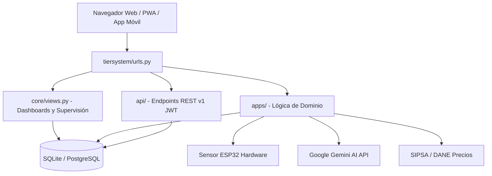
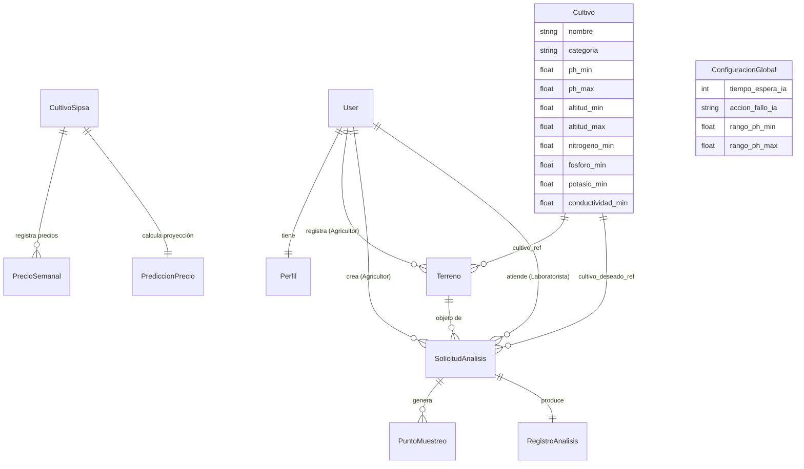
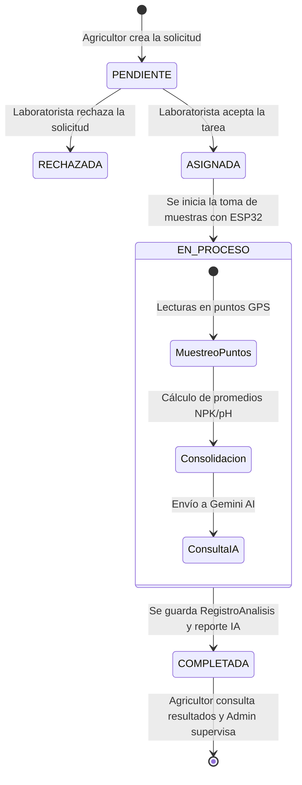

# Arquitectura, Rutas, Vistas y Base de Datos por Rol — TierSystem

Este documento detalla la estructura integral del proyecto **TierSystem**, explicando el funcionamiento técnico de las carpetas, el enrutamiento de URLs, la vinculación entre vistas y aplicaciones Django, y el modelo relacional de base de datos desglosado por cada uno de los tres roles: **Agricultor**, **Laboratorista** y **Administrador**.

---

## 1. Arquitectura Técnica Global

TierSystem está construido como una solución agro-tecnológica modular basada en el patrón arquitectónico **MVT (Model-View-Template)** de Django, extendido con una capa de **API REST** para dispositivos móviles e Internet de las Cosas (IoT).



### Componentes Clave:
* **Backend:** Python 3.10+ / Django 4.x / Django REST Framework (DRF).
* **Base de Datos:** SQLite para desarrollo local (`db.sqlite3`) mediante Django ORM.
* **Inteligencia Artificial:** Google Gemini AI para el diagnóstico edafológico automatizado.
* **Frontend Web:** Django Templates + Tailwind CSS + PWA (Service Worker con soporte offline) + SweetAlert2 local.
* **Hardware IoT:** Microcontrolador ESP32 conectado mediante endpoints HTTP telemétricos.

---

## 2. Mapa Detallado de Directorios

```text
TierSystem/
├── manage.py                          # Gestor CLI de Django (configurado por defecto en 0.0.0.0:8000)
├── db.sqlite3                         # Base de datos relacional SQLite
├── requirements.txt                   # Librerías (Django, djangorestframework, PyJWT, reportlab, openpyxl, etc.)
├── seed_cultivos.py                   # Script de sembrado de datos agrícolas de Huila
│
├── tiersystem/                        # Núcleo de Configuración
│   ├── settings.py                    # Variables de entorno, apps instaladas, JWT, DB y correo SMTP
│   ├── urls.py                        # Enrutador principal de Django con include()
│   ├── asgi.py                        # Interfaz ASGI
│   └── wsgi.py                        # Interfaz WSGI para servidores web (Nginx/Apache/Gunicorn)
│
├── core/                              # Orquestador General y Vistas de Dashboard
│   ├── views.py                       # Controladores de dashboards, exportaciones PDF/Excel y supervisión
│   ├── urls.py                        # Rutas de navegación base
│   └── cultivos_data.py               # Dataset referencial de cultivos del Huila
│
├── apps/                              # Módulos de Negocio Desacoplados
│   ├── usuarios/                      # Modelo Perfil, login, registro, cambio y reseteo de contraseña
│   ├── terrenos/                      # Fincas agrícolas, hectáreas y GeoJSON poligonal
│   ├── cultivos/                      # Catálogo canónico de especies, rangos edáficos y API offline
│   ├── solicitudes/                   # Ciclo de vida de solicitudes de análisis de suelo
│   ├── analisis/                      # Mediciones de laboratorio, NPK, pH y puntos GPS
│   ├── sensores/                      # Recepción de paquetes telemétricos del ESP32
│   ├── ia_recomendaciones/            # Integración con Gemini AI, CultivoIdeal y ConfiguracionGlobal
│   ├── sipsa/                         # Catálogo de precios mayoristas del DANE y proyecciones
│   └── mercado/                       # Consulta y comparativas de precios de venta
│
├── templates/                         # Vistas del Frontend
│   ├── agricultor/                    # Interfaz y dashboard del rol Agricultor
│   │   ├── base_dashboard.html        # Layout maestro con sidebar compacto y topbar
│   │   ├── dashboard.html             # Resumen de fincas, solicitudes y bento cards
│   │   ├── terrenos.html              # Mapeo y registro de fincas
│   │   ├── solicitudes.html           # Formulario y seguimiento de solicitudes
│   │   ├── historial.html             # Resultados edafológicos y diagnósticos de IA
│   │   ├── comparar.html              # Comparativa histórica de nutrientes
│   │   ├── cultivos.html              # Catálogo de cultivos
│   │   ├── mercado.html               # Precios SIPSA
│   │   ├── sipsa_dashboard.html       # Reportes DANE
│   │   └── perfil.html                # Edición de perfil y credenciales
│   ├── laboratorista/                 # Interfaz y dashboard del rol Laboratorista
│   │   ├── base_dashboard.html        # Layout maestro del técnico
│   │   ├── dashboard.html             # Métricas rápidas y accesos operativos
│   │   ├── solicitudes_pendientes.html# Banco de solicitudes por aceptar
│   │   ├── mis_solicitudes.html       # Tareas aceptadas con fecha de visita
│   │   ├── toma_muestras.html         # Panel de sincronización en vivo con ESP32
│   │   ├── historial.html             # Historial general de análisis procesados
│   │   └── perfil.html                # Perfil del laboratorista
│   ├── admin/                         # Interfaz del Administrador
│   │   ├── base_admin.html            # Layout maestro de administración
│   │   ├── dashboard.html             # Visión general y estadísticas del sistema
│   │   ├── usuarios.html              # Gestión de cuentas, altas y bloqueos
│   │   ├── supervision.html           # Auditoría de análisis con exportación PDF/Excel
│   │   ├── cultivos.html              # Configuración de rangos agronómicos ideales
│   │   ├── hardware.html              # Estado y monitoreo de los sensores ESP32
│   │   ├── configuracion.html         # Tiempos de espera de IA y calibraciones
│   │   └── perfil.html                # Perfil de administrador
│   └── usuarios/                      # Formularios de autenticación
│       ├── login.html                 # Inicio de sesión
│       ├── registro.html              # Registro de agricultores
│       └── password_reset*.html       # Flujo completo de recuperación de contraseña por email
│
├── api/                               # Capa REST API para Apps Móviles y Dispositivos
│   ├── urls.py                        # /api/v1/
│   ├── permissions.py                 # Permisos (IsAgricultor, IsLaboratorista, IsAdmin)
│   ├── auth/                          # Endpoints JWT de autenticación (/api/v1/auth/)
│   ├── agricultor/                    # Endpoints móviles de fincas, solicitudes y mercado
│   └── laboratorista/                 # Endpoints móviles de muestreo, sensor y órdenes
│
└── static/                            # Recursos Estáticos Locales (Offline Ready)
    ├── css/styles.css                 # Estilos SaaS personalizados
    ├── js/tailwindcss.js              # Framework CSS local
    ├── js/sweetalert2.all.min.js      # Modales interactivos locales
    ├── js/service-worker.js           # PWA Service Worker (tiersystem-cache-v3)
    └── fontawesome/                   # Iconografía vectorial local
```

---

## 3. Modelo de Datos y Esquema Relacional

El sistema está modelado mediante relaciones relacionales entre el usuario base de Django y las entidades agrícolas:



---

## 4. Funcionamiento Detallado por Rol

---

### ROL 1: AGRICULTOR

El Agricultor es el usuario final de producción. Sus funciones abarcan la gestión geográfica de sus terrenos, la solicitud de visitas técnicas o análisis en laboratorio, la consulta de resultados fisicoquímicos asistidos por IA y el seguimiento de precios oficiales del mercado agrícola.

#### A. Rutas y Vistas Asociadas
| Funcionalidad | Ruta URL | Controlador / Vista | Plantilla HTML |
| :--- | :--- | :--- | :--- |
| **Dashboard Principal** | `/agricultor/dashboard/` | `core.views.dashboard_agricultor` | `templates/agricultor/dashboard.html` |
| **Gestión de Fincas** | `/agricultor/fincas/` | `apps.terrenos.views.mis_terrenos` | `templates/agricultor/terrenos.html` |
| **Crear Terreno** | `/agricultor/fincas/crear/` | `apps.terrenos.views.crear_terreno` | Modal / Formulario en `terrenos.html` |
| **Mis Solicitudes** | `/agricultor/solicitudes/` | `apps.solicitudes.views.solicitudes_agricultor` | `templates/agricultor/solicitudes.html` |
| **Crear Solicitud** | `/agricultor/solicitudes/crear/` | `apps.solicitudes.views.crear_solicitud` | Modal / Formulario en `solicitudes.html` |
| **Historial & Detalle** | `/agricultor/solicitudes/historial/` | `apps.solicitudes.views.historial_analisis_agricultor` | `templates/agricultor/historial.html` |
| **Detalle de Resultado** | `/agricultor/solicitudes/resultado/<id>/` | `apps.solicitudes.views.resultado_detalle_agricultor` | `templates/agricultor/resultado_detalle.html` |
| **Comparativa Nutrientes**| `/agricultor/solicitudes/comparar/` | `apps.solicitudes.views.comparar_analisis_agricultor` | `templates/agricultor/comparar.html` |
| **Catálogo de Cultivos** | `/agricultor/cultivos/` | `core.views.catalogo_cultivos` | `templates/agricultor/cultivos.html` |
| **Precios SIPSA** | `/mercado/precios/` | `apps.mercado.views.precios_sipsa` | `templates/agricultor/mercado.html` |
| **Reportes DANE** | `/agricultor/sipsa/` | `apps.sipsa.views.dashboard_view` | `templates/agricultor/sipsa_dashboard.html` |
| **Perfil y Contraseña** | `/perfil/` | `apps.usuarios.views.perfil_view` | `templates/agricultor/perfil.html` |

#### B. Modelos de Base de Datos Utilizados
1. **`Terreno` (`apps.terrenos.models.Terreno`):**
   - Campos: `agricultor` (FK `User`), `nombre`, `ubicacion`, `hectareas`, `cultivo_principal`, `coordenadas_poligono` (JSON con coordenadas Leaflet), `fecha_registro`.
2. **`SolicitudAnalisis` (`apps.solicitudes.models.SolicitudAnalisis`):**
   - Campos: `agricultor`, `terreno`, `laboratorista_asignado`, `estado` (`PENDIENTE`, `ASIGNADA`, `EN_PROCESO`, `COMPLETADA`, `RECHAZADA`), `cultivo_deseado`, `modalidad` (`VISITA` o `LLEVAR_MUESTRA`), `fecha_visita`, `notas_agricultor`.
3. **`RegistroAnalisis` (`apps.analisis.models.RegistroAnalisis`):**
   - El agricultor lee el análisis producido por el laboratorista, que incluye promedios de pH, N, P, K y el campo `diagnostico_ia`.
4. **`CultivoSipsa` y `PrecioSemanal` (`apps.sipsa.models`):**
   - Permite al agricultor contrastar los precios del DANE en plazas mayoristas del Huila antes de sembrar.

---

### ROL 2: LABORATORISTA

El Laboratorista es el operador técnico de campo o laboratorio. Es responsable de inspeccionar las peticiones en espera, aceptar tareas, programar la fecha de visita, conectar el sensor físico ESP32, registrar las muestras geolocalizadas y disparar el análisis con Inteligencia Artificial.

#### A. Rutas y Vistas Asociadas
| Funcionalidad | Ruta URL | Controlador / Vista | Plantilla HTML |
| :--- | :--- | :--- | :--- |
| **Dashboard Operativo** | `/laboratorista/dashboard/` | `core.views.dashboard_laboratorista` | `templates/laboratorista/dashboard.html` |
| **Banco de Solicitudes** | `/laboratorista/solicitudes/pendientes/` | `apps.solicitudes.views.solicitudes_pendientes` | `templates/laboratorista/solicitudes_pendientes.html` |
| **Aceptar Solicitud** | `/laboratorista/solicitudes/aceptar/<id>/` | `apps.solicitudes.views.aceptar_solicitud` | Redirección POST |
| **Rechazar Solicitud** | `/laboratorista/solicitudes/rechazar/<id>/` | `apps.solicitudes.views.rechazar_solicitud` | Redirección POST |
| **Mis Tareas Asignadas**| `/laboratorista/solicitudes/mis-tareas/` | `apps.solicitudes.views.solicitudes_asignadas` | `templates/laboratorista/mis_solicitudes.html` |
| **Toma de Muestras / ESP32** | `/laboratorista/toma-muestras/` | `core.views.toma_muestras_laboratorista` | `templates/laboratorista/toma_muestras.html` |
| **Historial de Análisis**| `/laboratorista/analisis/historial/` | `apps.analisis.views.historial_analisis` | `templates/laboratorista/historial.html` |
| **API Sensor (Ingesta)**| `/api/lecturas/` | `apps.sensores.views.recibir_datos_sensor` | Ingesta HTTP POST telemetría ESP32 |
| **API Sensor Estable** | `/api/captura-estable/` | `apps.sensores.views.captura_estable` | Filtro anti-ruido (Moda/Mediana 15s) |
| **API Diagnóstico IA** | `/api/ia/generar-diagnostico/` | `apps.ia_recomendaciones.views.generar_diagnostico_view` | JSON con respuesta de Gemini |

#### B. Modelos de Base de Datos Utilizados
1. **`PuntoMuestreo` (`apps.analisis.models.PuntoMuestreo`):**
   - Cuando la modalidad es `VISITA`, el sistema genera automáticamente una cuadrícula de puntos según las hectáreas de la finca:
     - $\le 1 \text{ ha} \rightarrow 5 \text{ puntos}$.
     - $\le 5 \text{ ha} \rightarrow 10 \text{ puntos}$.
     - $\le 10 \text{ ha} \rightarrow 15 \text{ puntos}$.
     - $> 10 \text{ ha} \rightarrow 20 \text{ puntos}$.
   - Cada punto registra: `humedad`, `temperatura`, `conductividad`, `ph`, `nitrogeno`, `fosforo`, `potasio` y `estado` (`PENDIENTE` o `TOMADO`).
2. **`LecturaSensor` (`apps.sensores.models.LecturaSensor`):**
   - Almacena las lecturas telemétricas enviadas desde el microcontrolador ESP32 mediante una clave de seguridad `SENSOR_API_KEY`.
3. **`RegistroAnalisis` (`apps.analisis.models.RegistroAnalisis`):**
   - Entidad 1 a 1 con `SolicitudAnalisis`. Almacena los promedios globales calculados de todos los puntos tomados y el diagnóstico emitido por **Gemini AI**.

---

### ROL 3: ADMINISTRADOR

El Administrador tiene el control y gobierno integral de la plataforma: audita todos los análisis realizados, exporta reportes en formato PDF y Excel, gestiona las cuentas de los usuarios, calibra los rangos aceptables de los sensores y parametriza los requerimientos de nutrientes de los cultivos ideales.

#### A. Rutas y Vistas Asociadas
| Funcionalidad | Ruta URL | Controlador / Vista | Plantilla HTML |
| :--- | :--- | :--- | :--- |
| **Dashboard General** | `/administrador/dashboard/` | `core.views.dashboard_admin` | `templates/admin/dashboard.html` |
| **Gestión de Usuarios** | `/administrador/usuarios/` | `core.views.lista_usuarios` | `templates/admin/usuarios.html` |
| **Nuevo Laboratorista** | `/administrador/laboratoristas/nuevo/` | `core.views.crear_laboratorista` | Modal / Formulario en `usuarios.html` |
| **Cambiar Estado Cuenta**| `/administrador/usuarios/<id>/estado/` | `core.views.cambiar_estado_usuario` | Redirección POST |
| **Supervisión de Análisis**| `/administrador/supervision/` | `core.views.supervision_analisis` | `templates/admin/supervision.html` |
| **Exportar a PDF** | `/administrador/supervision/exportar-pdf/` | `core.views.exportar_pdf` | Stream binario `application/pdf` |
| **Exportar a Excel** | `/administrador/supervision/exportar-excel/` | `core.views.exportar_excel` | Stream binario `.xlsx` (`openpyxl`) |
| **Catálogo de Cultivos** | `/administrador/cultivos/` | `core.views.gestion_cultivos_admin` | `templates/admin/cultivos.html` |
| **Guardar Cultivo Ideal** | `/administrador/cultivos/guardar/` | `core.views.guardar_cultivo_admin` | Formulario POST |
| **Estado del Hardware** | `/administrador/hardware/` | `core.views.estado_hardware` | `templates/admin/hardware.html` |
| **Configuración Global** | `/administrador/configuracion/` | `core.views.configuracion_global_view` | `templates/admin/configuracion.html` |

#### B. Modelos de Base de Datos Utilizados
1. **`User` y `Perfil` (`django.contrib.auth` & `apps.usuarios`):**
   - El administrador activa/desactiva usuarios (`is_active`) y registra cuentas técnicas para laboratoristas asignando `rol='LABORATORISTA'`.
2. **`CultivoIdeal` (`apps.ia_recomendaciones.models.CultivoIdeal`):**
   - Contiene los rangos agronómicos de referencia: `humedad_min/max`, `temperatura_min/max`, `conductividad_min/max`, `ph_min/max`, `nitrogeno_min/max`, `fosforo_min/max`, `potasio_min/max`. Estos datos alimentan el prompt de Gemini AI para determinar si el suelo es apto.
3. **`ConfiguracionGlobal` (`apps.ia_recomendaciones.models.ConfiguracionGlobal`):**
   - Modelo Singleton (`pk=1` forzado). Controla el tiempo de espera de la IA (`tiempo_espera_ia`), la política ante caídas del servicio (`accion_fallo_ia`: usar base local o cancelar) y los límites de calibración física del sensor NPK/pH.

---

## 5. Ciclo de Vida de una Solicitud de Análisis



---

## 6. Configuración de Ejecución y Entorno de Red

* **Arranque del Servidor:**
  En el archivo `manage.py`, el comando `runserver` está configurado para enlazar por defecto a:
  ```python
  if len(sys.argv) == 2 and sys.argv[1] == 'runserver':
      sys.argv.append('0.0.0.0:8000')
  ```
  Esto permite que computadores en la misma red local (o el ESP32 por Wi-Fi) se comuniquen con el servidor usando la IP de la máquina (por ejemplo: `http://192.168.1.X:8000`).

* **Soporte PWA y Modo Offline:**
  - Archivo `static/js/service-worker.js`: Gestiona la caché `tiersystem-cache-v3` para almacenar los estilos Tailwind, FontAwesome y SweetAlert2.
  - Script local `static/js/sweetalert2.all.min.js`: Permite que la confirmación interactiva de cierre de sesión y las alertas funcionen sin conexión a internet.
