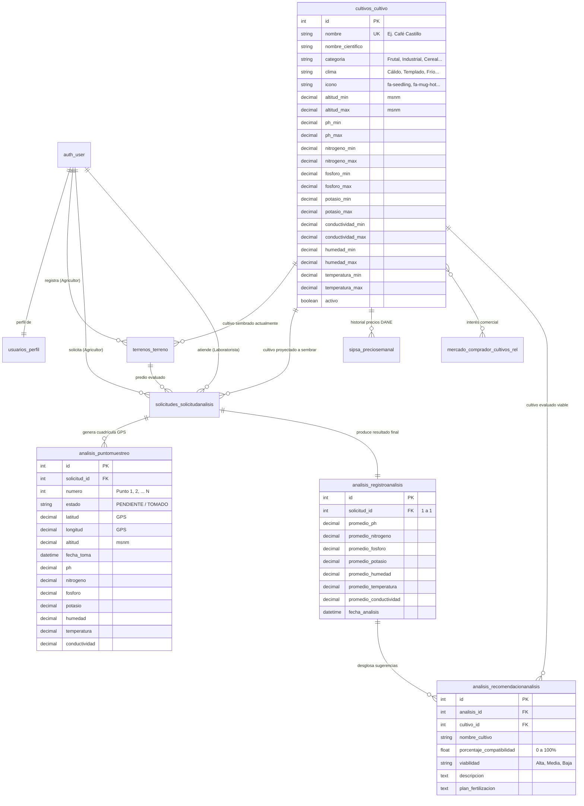
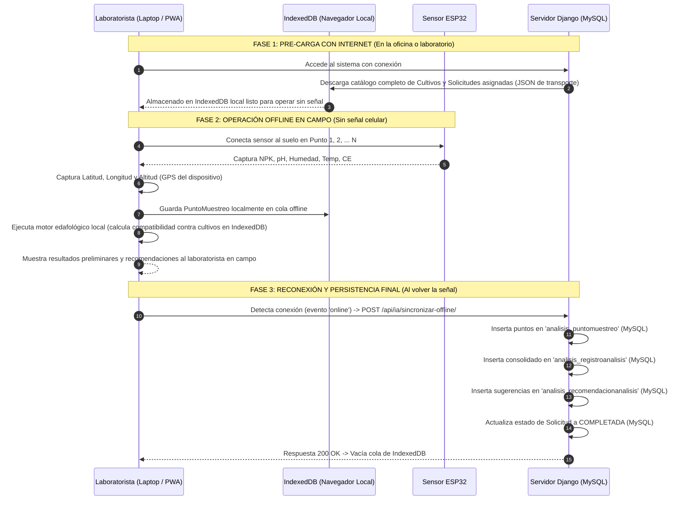

# Esquema de Arquitectura de Base de Datos y Modelo Offline — TierSystem

### Resumen del Esquema de Base de Datos (Definición Central)
El sistema **TierSystem** adopta una base de datos relacional pura en **MySQL** donde la entidad central de conocimiento agrícola es la tabla independiente y canónica **`cultivos_cultivo`** (alojada en su propio módulo `apps.cultivos`), la cual almacena de forma definitiva la taxonomía, pisos altitudinales (msnm) y rangos edafológicos óptimos (NPK, pH, conductividad, humedad y temperatura) de todos los cultivos del Huila; a partir de esta tabla maestra se desacoplan y relacionan rígidamente mediante claves foráneas las fincas (`terrenos_terreno`), las solicitudes de los agricultores (`solicitudes_solicitudanalisis`), los precios de mercado del DANE (`sipsa_preciosemanal`), los puntos georreferenciados en 3D (`analisis_puntomuestreo`) y las recomendaciones estructuradas emitidas por el motor de inteligencia artificial (`analisis_recomendacionanalisis`), erradicando cualquier persistencia en archivos estáticos o listas en código, y confinando el formato JSON exclusivamente como protocolo de transporte en red (APIs REST, telemetría ESP32, comunicación con Google Gemini) y como búfer temporal volátil en IndexedDB para el funcionamiento 100% offline en zonas rurales sin señal.

---

## 1. Justificación del Desacoplamiento: De `ia_recomendaciones` a `Cultivo` Propio

### El problema identificado
Anteriormente, la información de los cultivos estaba subordinada al módulo `ia_recomendaciones` (creando la tabla `ia_recomendaciones_cultivoideal`). Esto resultaba confuso y limitante porque:
1. **Un cultivo es una entidad agronómica y comercial transversal**, no es propiedad exclusiva de la IA. El agricultor tiene un cultivo en su finca, el mercado cotiza precios para ese cultivo y el laboratorio recibe solicitudes para evaluar ese cultivo.
2. La Inteligencia Artificial es un **consumidor** de la base de datos de cultivos, no su dueña.
3. Existía redundancia con `sipsa.CultivoSipsa` y con listas estáticas en archivos Python.

### La solución arquitectónica
Crear la aplicación dedicada **`apps.cultivos`** con el modelo **`Cultivo`** (tabla en MySQL: `cultivos_cultivo`).

```
                    ┌────────────────────────────────────────────────────────┐
                    │               apps.cultivos.Cultivo                    │
                    │               (cultivos_cultivo)                       │
                    │   Catálogo Maestro Universal de Cultivos del Huila     │
                    │   - Nombre, Categoría, Clima, Icono                    │
                    │   - Altitud Mín/Máx (msnm)                             │
                    │   - Rangos Óptimos: pH, N, P, K, Humedad, Temp, CE     │
                    └──────────────────────────┬─────────────────────────────┘
                                               │
         ┌───────────────────┬─────────────────┼──────────────────┬──────────────────┐
         ▼                   ▼                 ▼                  ▼                  ▼
┌─────────────────┐ ┌─────────────────┐ ┌───────────────┐ ┌───────────────┐ ┌────────────────┐
│ apps.terrenos   │ │ apps.solicitudes│ │ apps.analisis │ │  apps.sipsa   │ │  apps.mercado  │
│ Terreno         │ │ Solicitud       │ │ Recomendacion │ │ PrecioSemanal │ │   Comprador    │
│ cultivo_ref(FK) │ │ cultivo_ref(FK) │ │ cultivo_ref   │ │  cultivo (FK) │ │  cultivos(M2M) │
└─────────────────┘ └─────────────────┘ └───────▲───────┘ └───────────────┘ └────────────────┘
                                                │
                                                │ Consume datos para diagnosticar
                                                │
                                       ┌────────┴──────────────┐
                                       │ apps.ia_recomendaciones
                                       │ - Gemini AI (Online)  │
                                       │ - Algoritmo (Offline) │
                                       └───────────────────────┘
```

---

## 2. Diagrama Entidad-Relación Relacional (MySQL)



---

## 3. Delimitación Estricta: ¿Dónde se Usa Base de Datos y Dónde se Usa JSON?

Para cumplir con la directriz de que **los datos del negocio jamás se guarden en archivos JSON**:

| Información | ¿Dónde se Guarda? | ¿Usa JSON? | Propósito Técnico |
| :--- | :---: | :---: | :--- |
| **Catálogo de Cultivos** | **Tabla `cultivos_cultivo`** | NO | Base de datos MySQL. Se consulta con `Cultivo.objects.all()`. |
| **Puntos de Muestreo (3D)** | **Tabla `analisis_puntomuestreo`** | NO | Cada toma física con lat, lon, altitud y NPK es una fila en MySQL. |
| **Resultados Edafológicos** | **Tabla `analisis_registroanalisis`** | NO | Filas relacionales con promedios matemáticos en MySQL. |
| **Recomendaciones de IA** | **Tabla `analisis_recomendacionanalisis`** | NO | Cada cultivo recomendado se guarda como fila relacional con FK a `Cultivo`. |
| **Telemetría ESP32** | **Tabla `sensores_lecturasensor`** | Solo en tránsito | El ESP32 envía `POST` con payload JSON; el backend lo desempaqueta y lo inserta en MySQL de inmediato. |
| **Petición a Google Gemini** | Memoria / Red | Solo en tránsito | Se envía prompt a Gemini y se recibe la respuesta JSON; se parsea y se graba en las tablas relacionales. |
| **Modo Offline (En Campo)** | **Cache temporal en navegador** | Solo en IndexedDB | Al no haber internet en la finca, el navegador guarda temporalmente los puntos en `IndexedDB`. Al reconectar, se transfieren y guardan definitivamente en MySQL. |

---

## 4. Arquitectura y Funcionamiento del Análisis OFFLINE

En el departamento del Huila, gran parte de las fincas cafeteras y productoras carecen de cobertura celular o señal 3G/4G. La arquitectura offline opera mediante un ciclo en tres fases:



### Algoritmo Edafológico Offline (Cliente / PWA)
Cuando no hay internet para consultar la API de Google Gemini en la nube:
1. El motor offline toma el promedio local de los puntos tomados:
   $$\bar{pH}, \quad \bar{N}, \quad \bar{P}, \quad \bar{K}, \quad \bar{Altitud}$$
2. Itera sobre los cultivos almacenados en `IndexedDB`.
3. Calcula un índice de idoneidad edafológica ($0 - 100\%$) evaluando si el pH del lote cae en $[ph_{min}, ph_{max}]$, si el NPK satisface los mínimos requeridos y si la altitud del lote está dentro del piso térmico $[altitud_{min}, altitud_{max}]$.
4. Clasifica los 3 cultivos con mayor puntaje de compatibilidad.
5. Al reconectarse a internet, estos resultados y los puntos individuales se sincronizan y guardan permanentemente en las tablas de MySQL.

---

## 5. Plan de Transición Propuesto (Sin Romper Datos Actuales)

1. **Crear la app `apps.cultivos`**:
   - Modelo canónico `Cultivo` con tabla `cultivos_cultivo`.
2. **Migrar datos de `ia_recomendaciones_cultivoideal` hacia `cultivos_cultivo`**:
   - Copiar los 92 cultivos existentes a la nueva tabla con un script seguro de base de datos.
3. **Actualizar referencias de Foreign Keys**:
   - Apuntar `Terreno.cultivo_ref`, `SolicitudAnalisis.cultivo_deseado_ref`, `PrecioSemanal.cultivo` y `RecomendacionAnalisis.cultivo` hacia `apps.cultivos.models.Cultivo`.
4. **Optimizar `ia_recomendaciones`**:
   - Mantener en `ia_recomendaciones` únicamente la configuración global (`ConfiguracionGlobal`) y la lógica de inferencia (Gemini AI y endpoints), consumiendo el catálogo de `apps.cultivos`.
5. **Endpoints de Sincronización Offline**:
   - Endpoint `/api/cultivos/catalogo-offline/` para la pre-carga en `IndexedDB`.
   - Endpoint `/api/ia/sincronizar-offline/` optimizado para poblar en bloque las tablas MySQL al reconectar.
